<picture>
  <source media="(prefers-color-scheme: light)" srcset="_assets/banners/banner-topo-claro.webp">
  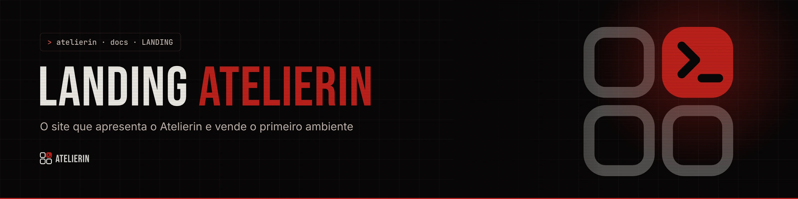
</picture>

<div align="center">

### Um ambiente seu, com a sua marca, para atender, ensinar, acompanhar e cobrar.


[Sobre](#-sobre-o-projeto) · [Seções](#-seções-e-páginas) · [Como rodar](#-como-rodar) · [Editar textos](#-editar-textos) · [Visual](#-visual) · [Estrutura](#-estrutura) · [Publicar](#-publicar) · [Documentação](#-documentação)

</div>

---

### $ sobre o projeto

Esta é a landing de [atelierin.com.br](https://atelierin.com.br). O **Atelierin** é uma plataforma para profissionais que atendem pessoas: professores, consultores, personal trainers, criativos e terapeutas. Cada cliente recebe um ambiente com a própria marca, num subdomínio próprio, para atender, ensinar, acompanhar e cobrar num lugar só. O produto nasceu do Atelier.sh, o painel que a autora usava com as turmas de técnico na ETE Cícero Dias.

A landing tem dois trabalhos: **explicar o que é um ambiente** sem jargão técnico e **levar a pessoa para uma conversa no WhatsApp**, já com a ficha preenchida. Ela também guarda as páginas que a autora manda nas negociações: a proposta comercial, os estudos de caso e o currículo.

O visual vem da identidade do Atelierin (noir e crimson, Bebas Neue, Inter e JetBrains Mono) com toques de terminal herdados do Atelier.sh. Todo texto mora em arquivos JSON, então trocar uma frase não exige mexer em componente.

> Site comercial em construção. A linha School é a única disponível hoje; as outras entram conforme a demanda.

<div align="center">
  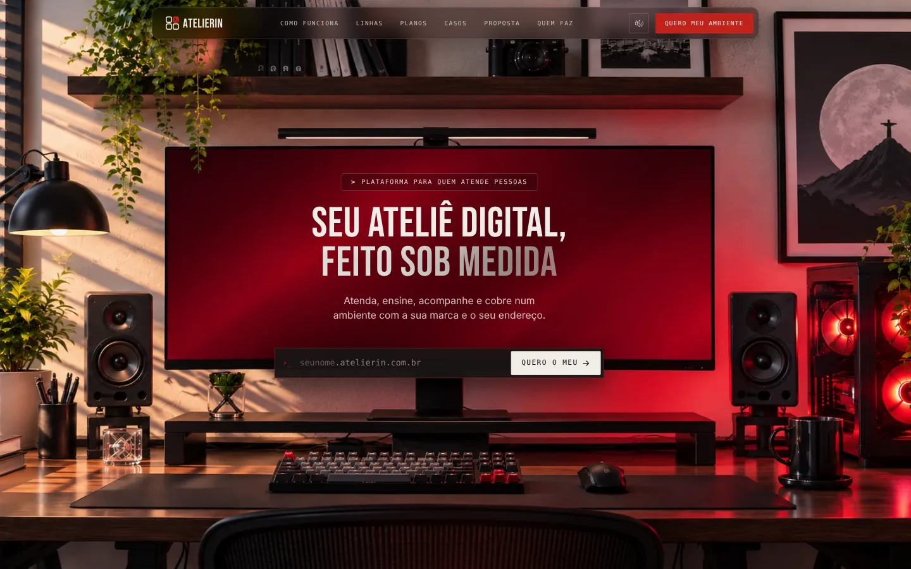
</div>

### $ seções e páginas

| Seção | O que mostra |
|---|---|
| **Hero** | Foto de uma mesa com monitor crimson. Título, texto e o campo de endereço ficam dentro da tela do monitor. A pessoa digita o nome e vê `nome.atelierin.com.br` |
| **Retalhos** (`#problema`) | Como o atendimento fica espalhado hoje (WhatsApp, Drive, agenda, planilha, Pix) em cards no estilo dos grupos do Atelier.sh, com filtro e uma costura animada que desce até a próxima seção |
| **Como funciona** | Núcleo, módulos e linhas. Termina com "Você escolhe as peças", centralizado entre o escuro e o claro |
| **Passo a passo** | Conversa, molde, prova, ajuste e no ar, numa trilha que se preenche com a rolagem. Cada passo tem uma animação própria |
| **Linhas** | School, Consult, Fit, Studio e Care, com selo de status |
| **Sob medida** | "A marca é sua": três estilos de login que se trocam com uma transição em círculo |
| **Planos** | School Personalizado (10x de R$ 300 + 8%), Padrão e Outras linhas, com o comparativo "com ou sem manutenção" |
| **Dúvidas** | Perguntas frequentes, inclusive sobre preço e manutenção |
| **Ficha** (`#contato`) | "Vamos tirar as suas medidas": a ficha monta uma mensagem e abre o WhatsApp |
| **Rodapé** | Texto sobre a ilustração carmesim |

| Página | Caminho | Conteúdo |
|---|---|---|
| Início | `/` | A landing |
| Quem faz | `/quem-faz` | Currículo da autora, com foto |
| Proposta | `/proposta` | Como funciona contratar um ambiente, em blocos no formato de slide |
| Casos | `/casos` | Estudos de caso. O primeiro é o Atelier.sh na ETE |

<table>
<tr>
<td width="50%">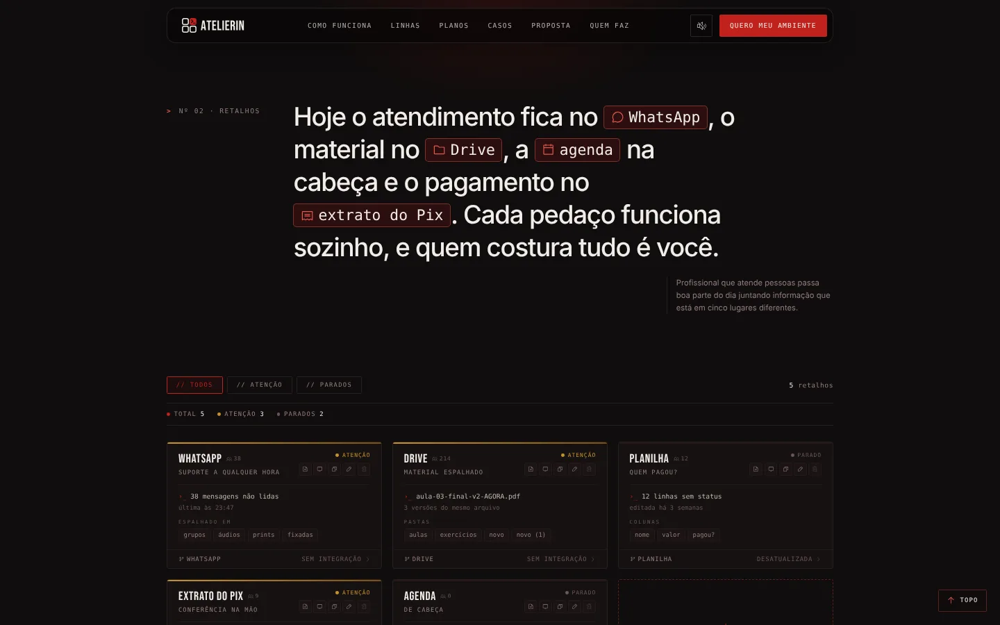</td>
<td width="50%">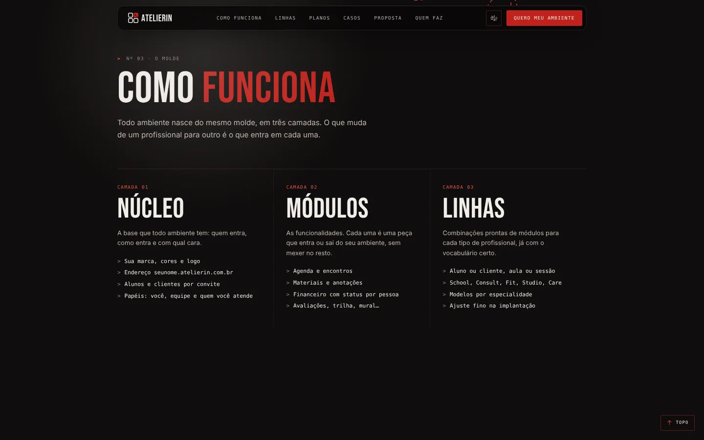</td>
</tr>
<tr>
<td align="center"><sub>Retalhos: cada pedaço do atendimento num lugar diferente</sub></td>
<td align="center"><sub>Como funciona: núcleo, módulos e linhas</sub></td>
</tr>
<tr>
<td width="50%">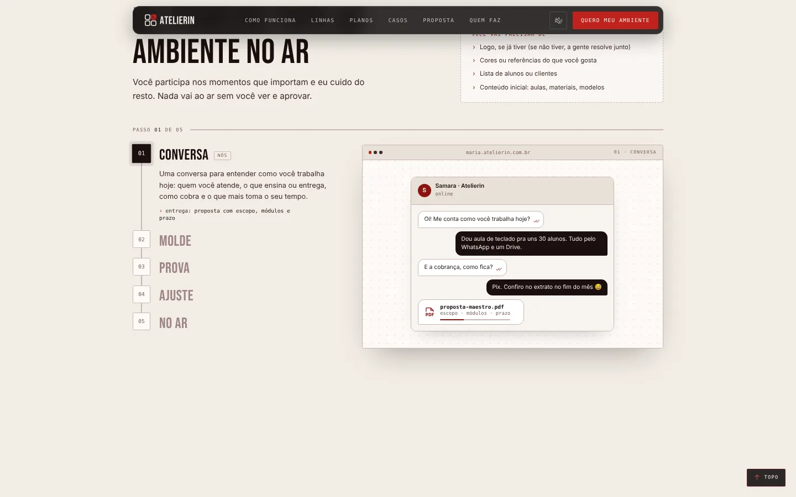</td>
<td width="50%">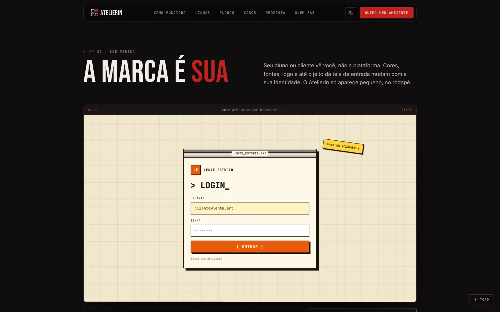</td>
</tr>
<tr>
<td align="center"><sub>Passo a passo, do primeiro contato ao ambiente no ar</sub></td>
<td align="center"><sub>A marca é sua: o login muda de estilo</sub></td>
</tr>
<tr>
<td width="50%">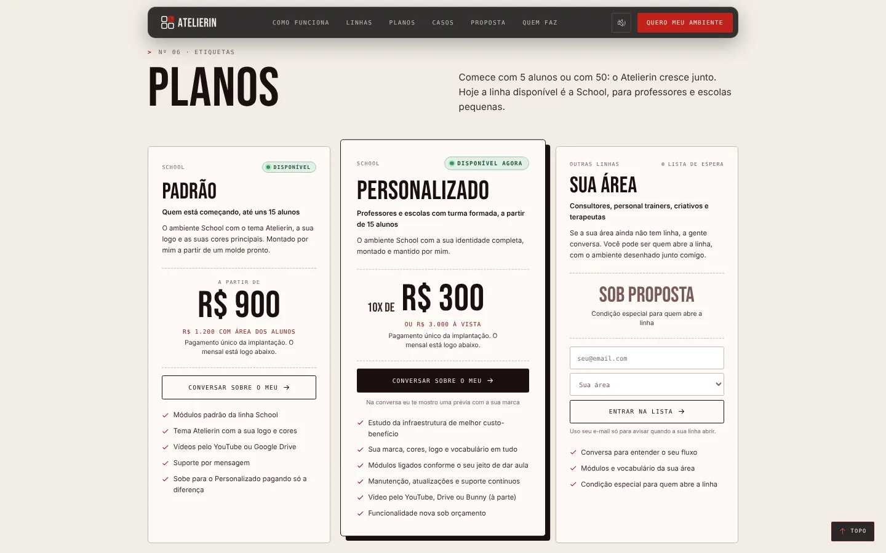</td>
<td width="50%">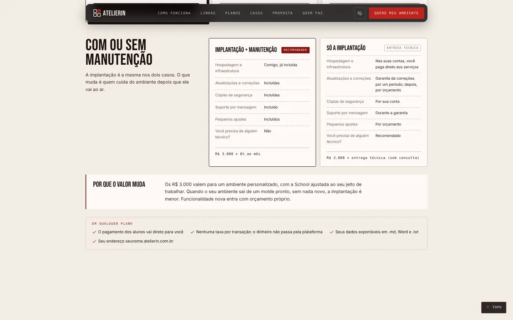</td>
</tr>
<tr>
<td align="center"><sub>Planos: 10x de R$ 300 em destaque</sub></td>
<td align="center"><sub>Comparativo de manutenção</sub></td>
</tr>
<tr>
<td width="50%">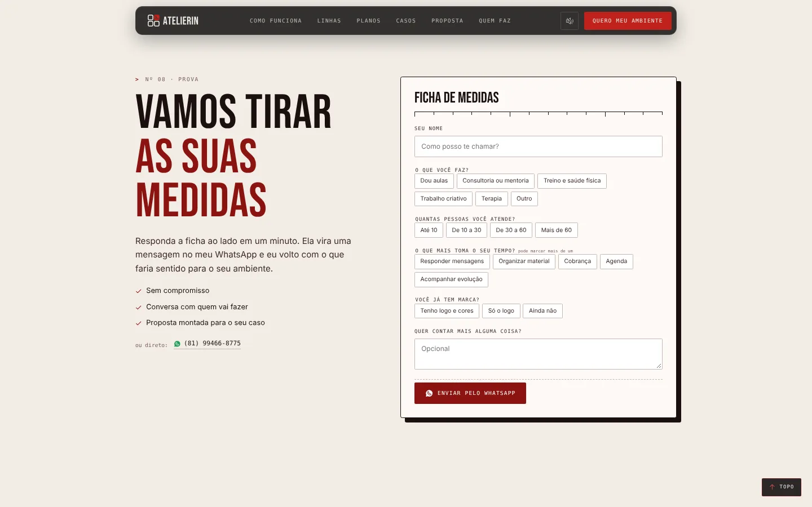</td>
<td width="50%">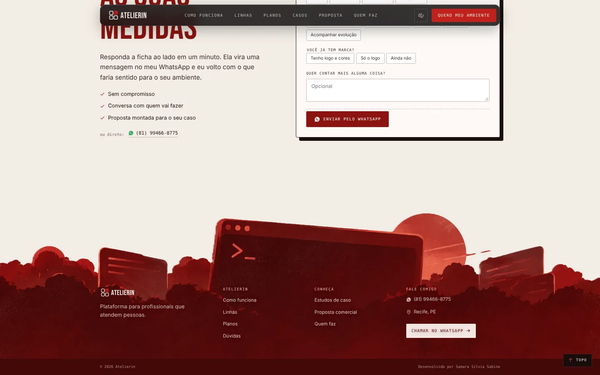</td>
</tr>
<tr>
<td align="center"><sub>Ficha: a mensagem do WhatsApp sai pronta</sub></td>
<td align="center"><sub>Rodapé sobre a ilustração</sub></td>
</tr>
<tr>
<td width="50%">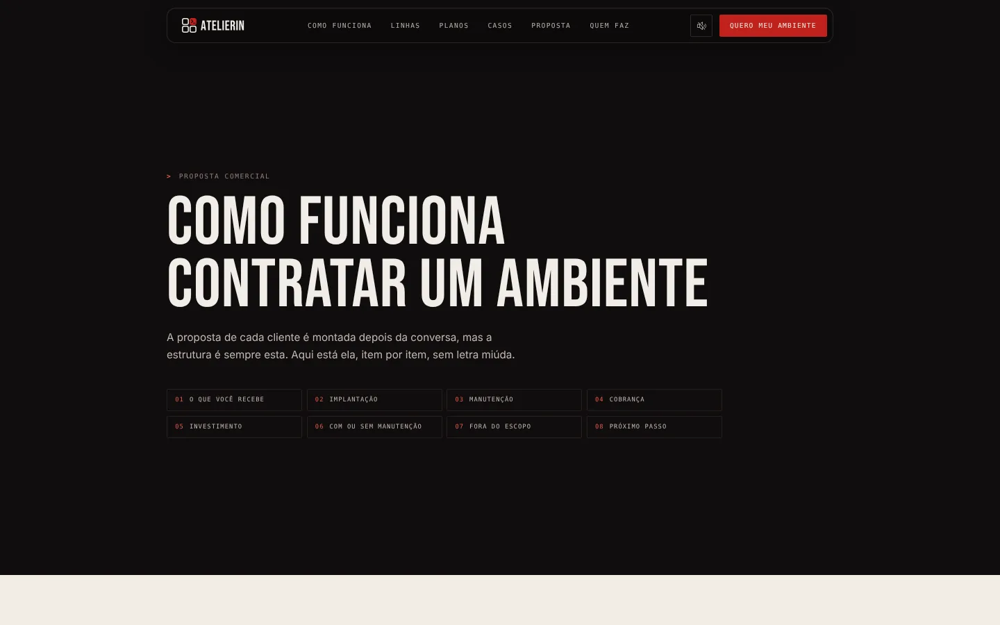</td>
<td width="50%">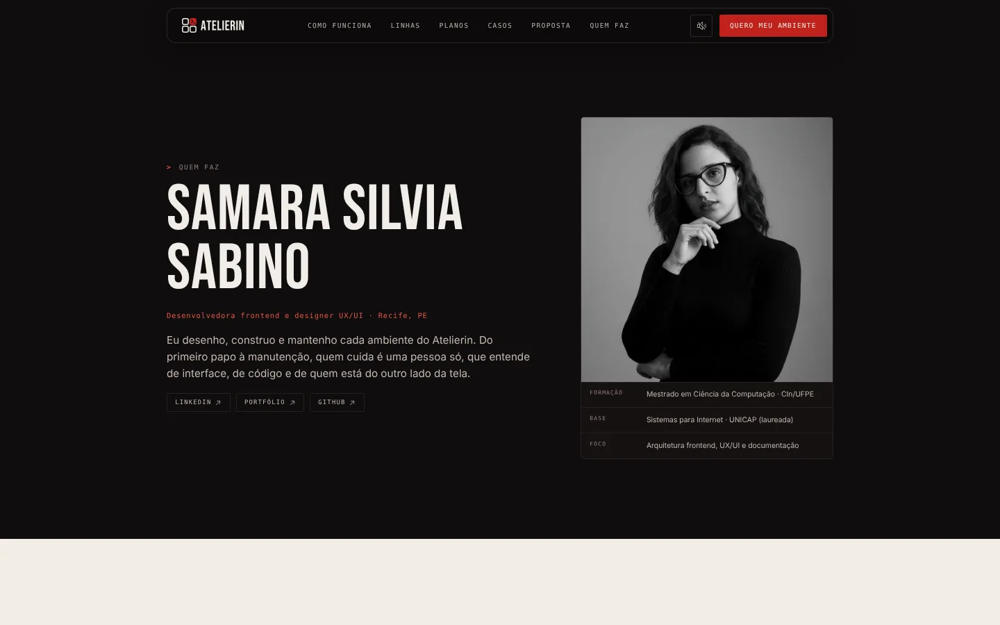</td>
</tr>
<tr>
<td align="center"><sub>Proposta comercial em slides</sub></td>
<td align="center"><sub>Quem faz</sub></td>
</tr>
</table>

### $ como rodar

#### 1. Pré-requisitos

```bash
node -v    # 20 ou mais
yarn -v    # se faltar: npm install -g yarn
```

#### 2. Instalar e abrir

```bash
yarn            # instala as dependências
yarn dev        # abre em http://localhost:5173
```

| Comando | O que faz |
|---|---|
| `yarn dev` | Desenvolvimento, com recarga automática e o botão **Editar layout** do hero |
| `yarn build` | Gera o site final em `dist/` |
| `yarn preview` | Serve o `dist/` em `http://localhost:4173`, do jeito que vai ao ar |

### $ editar textos

Todo texto fica em `src/content/`. O passo a passo completo, com o modo Figma do hero, está no [`LP-OPR-001`](docs/LP-OPR-001-operacao-e-conteudo.md).

| Arquivo | O que tem |
|---|---|
| `content.json` | Contato (WhatsApp, e-mail), navegação, hero, retalhos, como funciona, passo a passo, sob medida, planos, ficha e rodapé |
| `lines.json` | Uma entrada por linha (School, Consult, Fit, Studio, Care) |
| `faq.json` | Perguntas e respostas |
| `pages.json` | Quem faz, Proposta e Casos |

Para esconder uma seção, coloque `"enabled": false` no bloco dela em `content.json`.

### $ visual

| Item | Valor |
|---|---|
| Cores | Noir `#080606`, osso `#F0EDE8`, crimson `#C0211C`; no claro, areia `#F2EDE6` e sangue `#8B1410` |
| Fontes | Bebas Neue (títulos), Inter (texto), JetBrains Mono (rótulos e dados) |
| Ícones | Phosphor |
| Escala | No desktop (a partir de 1100 px) a página inteira aparece em 80% |
| Temas | As seções alternam escuro e claro; a troca acontece com a seção saindo de cena como um cartão |
| Movimento | Tudo respeita "reduzir movimento" do sistema |
| Sons | Herdados do Atelier.sh, desligados por padrão, com botão na topbar |

Os detalhes estão no [`LP-DSG-001`](docs/LP-DSG-001-sistema-visual.md). A identidade completa da marca está em `03-DESIGN/01-MARCA` (MAR-001 a MAR-003).

<div align="center">
  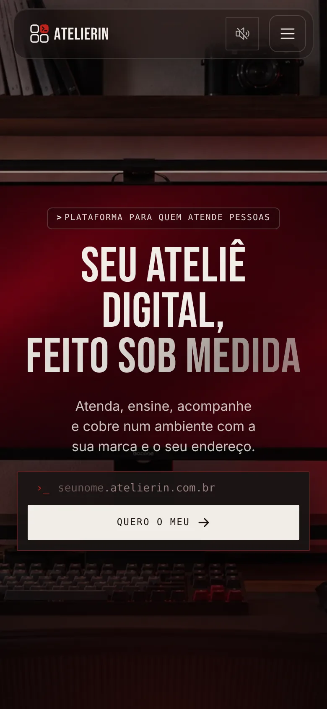
  <br><sub>No celular os blocos do hero saem do monitor e ficam empilhados</sub>
</div>

### $ estrutura

```
04-ATELIERIN-LANDING/
├── _assets/
│   ├── banners/          banners do README e dos docs (escuro e claro, WebP)
│   ├── gerador/          presets dos banners para o gerador da marca
│   └── prints/           capturas usadas no README e nos docs
├── docs/                 documentação da landing (ver docs/README.md)
├── public/
│   ├── brand/            logos SVG (cópias de 03-DESIGN/01-MARCA/logos)
│   ├── hero-desk.webp    foto do hero
│   ├── footer-carmesim.webp  ilustração do rodapé
│   ├── samara.webp       foto da página Quem faz
│   ├── caso-atelier-sh-ete.webp
│   └── _redirects        manda qualquer caminho para o index.html
├── src/
│   ├── content/          TODO o texto (JSON)
│   ├── lib/              leitura do conteúdo, roteador, hooks de rolagem, sons
│   ├── components/       peças reutilizáveis (Header, ExitStage, Pipeline...)
│   ├── sections/         uma seção da home por arquivo, na ordem da página
│   ├── pages/            Quem faz, Proposta, Casos
│   ├── styles/
│   │   ├── tokens.css    cópia dos tokens da marca
│   │   └── global.css    layout e componentes
│   ├── App.jsx           monta a home e escolhe a página pelo caminho
│   └── main.jsx
├── CHANGELOG.md
└── README.md
```

A arquitetura está no [`LP-ARQ-001`](docs/LP-ARQ-001-arquitetura.md) e o mapa de cada seção no [`LP-ARQ-002`](docs/LP-ARQ-002-mapa-de-secoes.md).

### $ publicar

Cloudflare Pages, ligado ao repositório:

| Campo | Valor |
|---|---|
| Comando de build | `yarn build` |
| Pasta de saída | `dist` |
| Node | 20 ou mais |

O `public/_redirects` faz `/proposta`, `/casos` e `/quem-faz` abrirem direto, sem 404.

**Antes de publicar**

- [x] WhatsApp em `site.whatsapp`
- [ ] E-mail completo em `site.contactEmail`
- [ ] Decidir a oferta de Assinatura e a opção sem manutenção ([`LP-ADR-005`](docs/decisoes/LP-ADR-005-preco-na-pagina.md))
- [ ] Imagens reais na trilha do passo a passo (hoje são ilustrações de exemplo)
- [ ] Imagem de compartilhamento (`og:image`) 1200x630
- [ ] Revisar textos com o caso real do Maxwell, com autorização dele
- [ ] Remover `src/components/BrandMorph.jsx`, que não é mais usado

### $ documentação

| Código | Título |
|---|---|
| [`LP-ARQ-001`](docs/LP-ARQ-001-arquitetura.md) | Arquitetura: camadas, rotas, conteúdo em JSON e como a página monta |
| [`LP-ARQ-002`](docs/LP-ARQ-002-mapa-de-secoes.md) | Mapa de seções e páginas: texto, componente e comportamento de cada uma |
| [`LP-DSG-001`](docs/LP-DSG-001-sistema-visual.md) | Sistema visual: tokens, temas por seção, escala de 80% e animações |
| [`LP-OPR-001`](docs/LP-OPR-001-operacao-e-conteudo.md) | Operação: rodar, editar textos, ajustar o hero, publicar |
| [`LP-ADR-001`](docs/decisoes/LP-ADR-001-conteudo-em-json.md) | Conteúdo em JSON |
| [`LP-ADR-002`](docs/decisoes/LP-ADR-002-roteador-proprio.md) | Roteador próprio |
| [`LP-ADR-003`](docs/decisoes/LP-ADR-003-escala-de-80.md) | Escala de 80% no desktop |
| [`LP-ADR-004`](docs/decisoes/LP-ADR-004-troca-de-tema-em-cartao.md) | Troca de tema em cartão |
| [`LP-ADR-005`](docs/decisoes/LP-ADR-005-preco-na-pagina.md) | Preço na página |

A documentação do produto (visão, linhas, planos, roadmap) fica em `PRD-ATELIERIN/00-DOCS`. O histórico de versões da landing está no [`CHANGELOG.md`](CHANGELOG.md).

<div align="center">

*Cada pedaço do seu atendimento, costurado num lugar só.*

Feito por [Samara Silvia](https://github.com/SamaraSilvia81) · Recife, PE

</div>

<picture>
  <source media="(prefers-color-scheme: light)" srcset="_assets/banners/banner-rodape-claro.webp">
  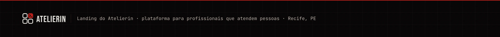
</picture>
