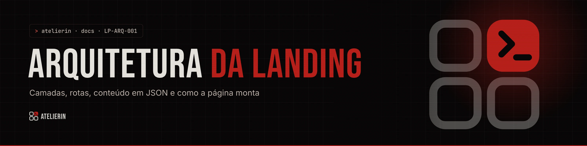
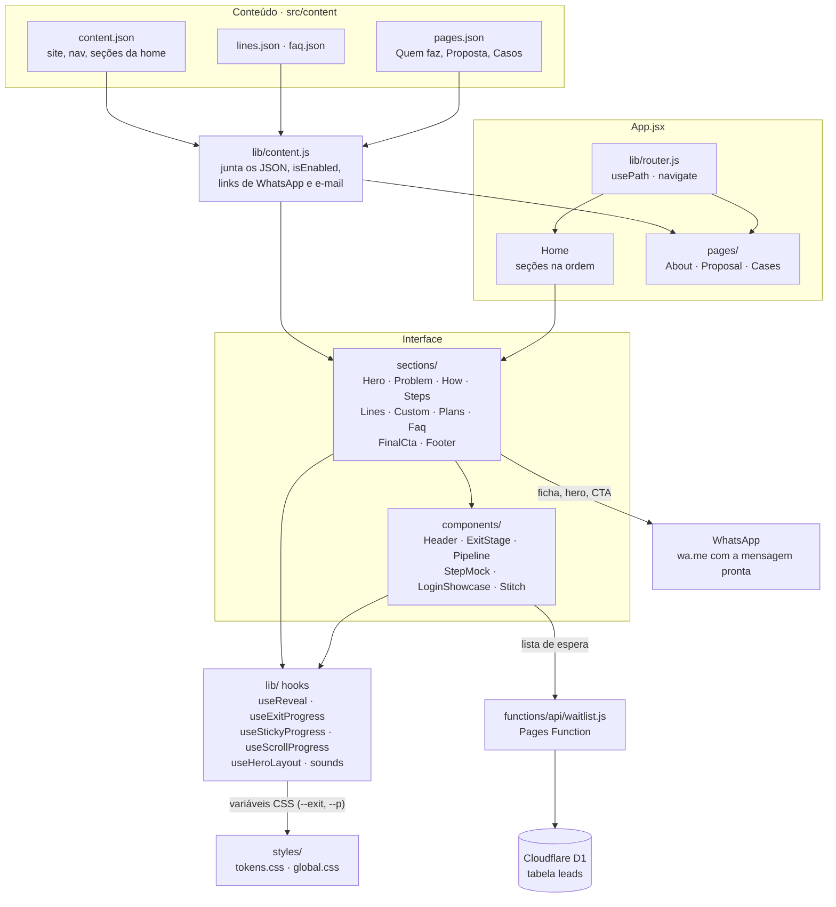
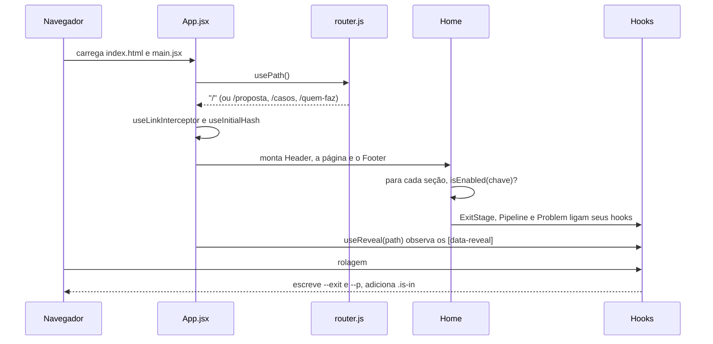
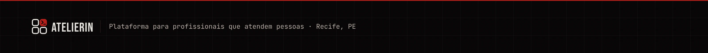

<picture>
  <source media="(prefers-color-scheme: light)" srcset="../_assets/banners/docs/lp-arq-001-claro.webp">
  
</picture>

# LP-ARQ-001 · Arquitetura da landing

  

| Campo | Valor |
|---|---|
| Código | `LP-ARQ-001` |
| Data | quarta-feira, 11/11/2026 |
| Tipo | Arquitetura |
| Status | Vigente |
| Versão do site | 0.1.0 |
| Referências | [`LP-ARQ-002`](LP-ARQ-002-mapa-de-secoes.md) · [`LP-DSG-001`](LP-DSG-001-sistema-visual.md) · [`LP-ADR-001`](decisoes/LP-ADR-001-conteudo-em-json.md) · [`LP-ADR-002`](decisoes/LP-ADR-002-roteador-proprio.md) · [`LP-ADR-003`](decisoes/LP-ADR-003-escala-de-80.md) |
| Redigido por | Samara Silvia |

**Sumário**

1. [Em uma frase](#-em-uma-frase)
2. [Camadas](#-camadas)
3. [Como a página monta](#-como-a-página-monta)
4. [Rotas](#-rotas)
5. [Conteúdo](#-conteúdo)
6. [Hooks de rolagem](#-hooks-de-rolagem)
7. [Dependências](#-dependências)
8. [Pontos de atenção](#-pontos-de-atenção)

---

### $ em uma frase

A landing é um site estático em **React 19 + Vite 7**. A única parte com servidor é a lista de espera: uma **Pages Function** que grava no **Cloudflare D1** e envia e-mail pelo **Resend**. Os textos ficam em **JSON** e passam por um único ponto de leitura (`lib/content.js`). Um **roteador próprio** troca entre quatro páginas. As animações são feitas com **hooks de rolagem** que escrevem variáveis CSS, e o CSS faz o resto.

### $ camadas



| Camada | Responsabilidade | Não faz |
|---|---|---|
| `content/*.json` | Guardar todo texto, rótulo, preço e link | Saber como é desenhado |
| `lib/content.js` | Juntar os JSON num objeto só, dizer se uma seção está ligada, montar os links de WhatsApp e e-mail | Renderizar |
| `App.jsx` | Escolher a página pelo caminho e montar a home na ordem certa | Ter texto |
| `sections/` | Uma seção da home por arquivo. Lê o próprio bloco de `content` | Ler o bloco de outra seção |
| `components/` | Peças reutilizáveis e animações maiores | Ler conteúdo direto (recebe por props, com exceção do Header) |
| `lib/` hooks | Medir rolagem e escrever progresso em variáveis CSS | Mudar layout direto (quem desenha é o CSS) |
| `styles/` | Tokens da marca e todo o layout | Ter valores soltos de cor fora dos tokens |
| `functions/api/` | Receber o formulário da lista de espera, gravar no D1 e mandar o e-mail | Servir páginas |

A regra que mais importa: **componente não tem texto escrito à mão**. Tudo vem de `content`, então trocar uma frase é editar JSON ([`LP-ADR-001`](decisoes/LP-ADR-001-conteudo-em-json.md)).

### $ como a página monta



A home segue esta ordem, definida em `App.jsx`:

| # | Seção | Envolvida por | Tema |
|---|---|---|---|
| 1 | `Hero` | | escuro |
| 2 | `Problem` (retalhos) | | escuro |
| 3 | `How` (como funciona) | `ExitStage to="light"` | escuro |
| 4 | `Steps` (passo a passo) | | claro |
| 5 | `Lines` | `ExitStage to="dark"` | claro |
| 6 | `Custom` (a marca é sua) | `ExitStage to="light"` | escuro |
| 7 | `Plans` | | claro |
| 8 | `Faq` | | escuro |
| 9 | `FinalCta` (ficha) | | claro |
| | `Footer` | fora do `main` | escuro, sobre a ilustração carmesim |

### $ rotas

| Caminho | Componente | Texto em |
|---|---|---|
| `/` | `Home` em `App.jsx` | `content.json`, `lines.json`, `faq.json` |
| `/quem-faz` | `pages/About.jsx` | `pages.json > about` |
| `/proposta` | `pages/Proposal.jsx` | `pages.json > proposal` |
| `/casos` | `pages/Cases.jsx` | `pages.json > cases` |
| qualquer outro | `Home` | |

O roteador ([`LP-ADR-002`](decisoes/LP-ADR-002-roteador-proprio.md)) tem quatro funções:

| Função | O que faz |
|---|---|
| `usePath()` | Devolve o caminho atual, sem barra no fim. Atualiza com `popstate` e com `navigate` |
| `navigate(to)` | `pushState` para outra página e volta ao topo. Se tiver `#ancora`, rola até ela |
| `useLinkInterceptor()` | Intercepta cliques em qualquer `<a href="/...">`, então os links do JSON funcionam sem componente especial |
| `useInitialHash()` | Ao abrir `/#planos` direto, rola até a seção depois que a página monta |

No ar, o `public/_redirects` (`/*  /index.html  200`) faz o Cloudflare Pages entregar o `index.html` em qualquer caminho.

### $ conteúdo

```js
// lib/content.js
export const content = { ...base, lines: { ...base.lines, items: lines }, faq, pages }
export const isEnabled = (key) => content[key] && content[key].enabled !== false
```

| Função | Uso |
|---|---|
| `content` | Objeto com tudo. Cada seção lê `content.<chave>` |
| `isEnabled(chave)` | Esconde a seção quando o bloco tem `"enabled": false` |
| `whatsappHref()` | Link do WhatsApp com a mensagem padrão de `site.whatsappMessage` |
| `whatsappWith(texto)` | Link do WhatsApp com um texto montado (ficha, hero) |
| `mailHref(corpo)` | `mailto:` com assunto "Atelierin · minha ficha". Devolve `null` se `site.contactEmail` estiver vazio, e o botão de e-mail some |

### $ hooks de rolagem

Todos param de animar com **reduzir movimento** do sistema e mostram o estado final.

| Hook | Onde | O que escreve |
|---|---|---|
| `useReveal(path)` | `App` | Adiciona `.is-in` nos `[data-reveal]` quando entram na tela. Roda de novo a cada troca de página |
| `useExitProgress(ref)` | `ExitStage` | `--exit` de 0 a 1 no primeiro filho, conforme a base da seção sobe. O CSS encolhe e arredonda ([`LP-ADR-004`](decisoes/LP-ADR-004-troca-de-tema-em-cartao.md)) |
| `useStickyProgress(ref, steps)` | `Pipeline` | `--p` de 0 a 1 num contêiner alto com conteúdo `sticky`, e o passo ativo |
| `useScrollProgress()` | `Problem` | Progresso da costura (`Stitch`) atravessando a tela |
| `useHeroLayout()` | `Hero` | Posição e escala dos blocos do hero. Modo Figma só em `yarn dev` ou com `?editar` |

Com o zoom de 80% ([`LP-ADR-003`](decisoes/LP-ADR-003-escala-de-80.md)), `getBoundingClientRect` pode vir em pixels visuais ou em pixels de layout, dependendo do navegador. Os hooks comparam `rect.width` com `offsetWidth` para descobrir qual é e corrigem a altura da tela.

### $ dependências

| Pacote | Para quê |
|---|---|
| `react`, `react-dom` 19 | Interface |
| `vite` 7, `@vitejs/plugin-react` | Desenvolvimento e build. Alias `@` aponta para `src/` |
| `@phosphor-icons/react` | Ícones |
| `@fontsource/bebas-neue`, `@fontsource-variable/inter`, `@fontsource-variable/jetbrains-mono` | Fontes servidas pelo próprio site, sem Google Fonts |

Sem biblioteca de rotas, de animação ou de estado. O som é sintetizado com Web Audio, sem arquivos de áudio.

### $ pontos de atenção

- **Código sem uso:** `components/BrandMorph.jsx` ficou de uma versão anterior e não é importado. No computador da autora ainda existem `Ruler.jsx`, `public/hero-desk.png` e `public/footer-carmesim.png`, também sem uso.
- **`global.css` tem mais de mil linhas.** Está dividido por comentários na ordem das seções. Se crescer mais, vale separar por seção.
- **Imagens do passo a passo:** enquanto `how.steps.items[].image.src` estiver vazio, aparece a telinha animada do `StepMock`.
- **Sem testes automatizados.** A conferência é visual, com capturas por seção.

---

<picture>
  <source media="(prefers-color-scheme: light)" srcset="../_assets/banners/docs/rodape-claro.webp">
  
</picture>
