<picture>
  <source media="(prefers-color-scheme: light)" srcset="../_assets/banners/docs/lp-arq-002-claro.webp">
  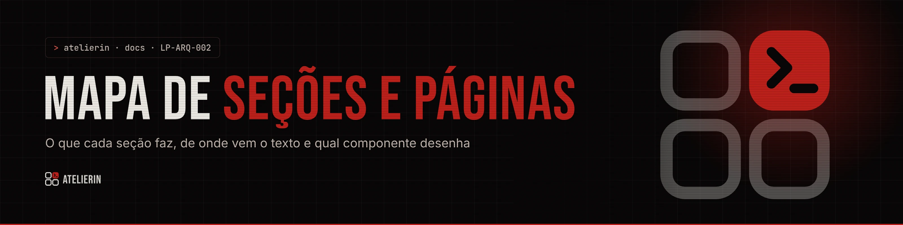
</picture>

# LP-ARQ-002 · Mapa de seções e páginas

  

| Campo | Valor |
|---|---|
| Código | `LP-ARQ-002` |
| Data | quarta-feira, 11/11/2026 |
| Tipo | Arquitetura |
| Status | Vigente |
| Versão do site | 0.1.0 |
| Referências | [`LP-ARQ-001`](LP-ARQ-001-arquitetura.md) · [`LP-DSG-001`](LP-DSG-001-sistema-visual.md) · [`LP-OPR-001`](LP-OPR-001-operacao-e-conteudo.md) |
| Redigido por | Samara Silvia |

**Sumário**

1. [Visão da página](#-visão-da-página)
2. [Hero](#-hero)
3. [Retalhos](#-retalhos)
4. [Como funciona](#-como-funciona)
5. [Passo a passo](#-passo-a-passo)
6. [Linhas](#-linhas)
7. [A marca é sua](#-a-marca-é-sua)
8. [Planos](#-planos)
9. [Dúvidas](#-dúvidas)
10. [Ficha](#-ficha)
11. [Rodapé](#-rodapé)
12. [Páginas internas](#-páginas-internas)
13. [Celular](#-celular)

---

### $ visão da página

A home conta uma história em quatro tempos: **o problema** (o atendimento espalhado), **a solução** (como um ambiente é montado), **a oferta** (linhas, marca e planos) e **o convite** (a ficha que vira conversa no WhatsApp).

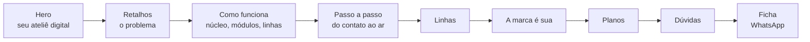

Cada seção abaixo traz: arquivo, bloco de texto, comportamento e o que observar ao editar.

### $ hero

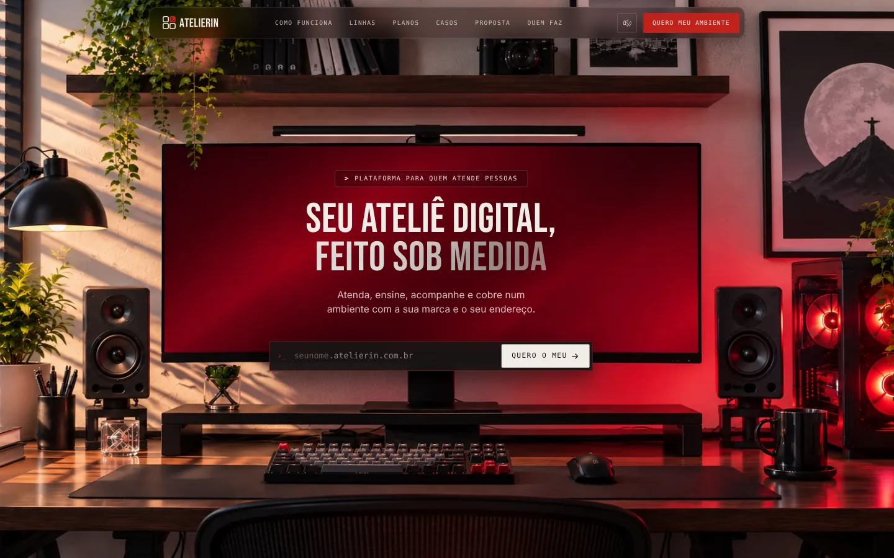

| Item | Valor |
|---|---|
| Arquivo | `sections/Hero.jsx` |
| Texto | `content.hero` (`badge`, `titleLine1`, `titleLine2`, `lede`, `addressPrompt`, `addressSuffix`, `cta`, `ctaMessage`, `layout`) |
| Imagem | `public/hero-desk.webp`, com `hero-desk.jpg` de reserva |

- A foto ocupa a tela inteira e **mantém a proporção** (1589 × 989). A tela do monitor é uma caixa fixa dentro dela (`left 18,5% · top 26,19% · width 59,47% · height 36,8%`), então os textos acompanham o monitor em qualquer tamanho de tela deitada.
- A posição de cada bloco vem de `hero.layout` e é ajustada no **modo Figma** ([`LP-OPR-001`](LP-OPR-001-operacao-e-conteudo.md#-ajustar-o-hero)).
- O campo de endereço mostra `nome.atelierin.com.br` enquanto a pessoa digita. O botão abre o WhatsApp com esse endereço na mensagem.
- Segunda linha do título com efeito prata.

### $ retalhos

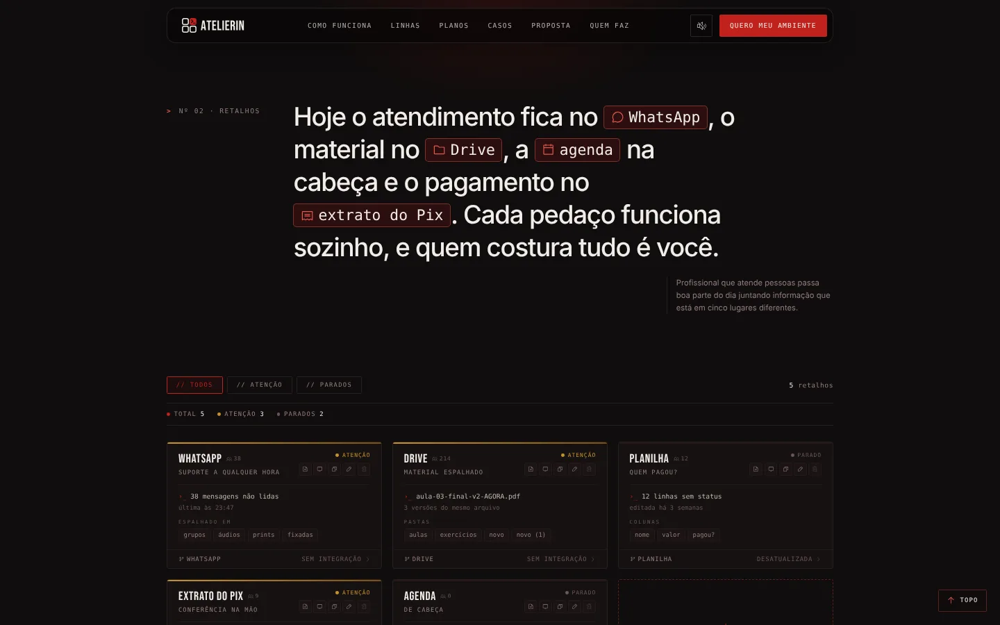

| Item | Valor |
|---|---|
| Arquivo | `sections/Problem.jsx`, `components/Stitch.jsx` |
| Texto | `content.problem` (`statement`, `chips`, `scraps`, `filters`, `closing`, `next`, `addCard`) |

- A frase de abertura tem **chips** no estilo de etiqueta de terminal (WhatsApp, Drive, agenda, extrato do Pix).
- Os **retalhos** são cards no formato dos grupos do Atelier.sh, com filtro por tipo e contador. Ao filtrar, os cards entram com a animação `card-in` (não usam `data-reveal`, porque são recriados).
- A **costura** (`Stitch`) é uma linha de alinhavo que sai do texto de fechamento, faz duas laçadas e aponta para "Como funciona". O desenho vem de pontos num rascunho 1200 × 560, escalado para a largura disponível, e se desenha conforme a rolagem.
- A mancha clara à esquerda avança para dentro da seção seguinte. Por isso `.problem` tem `z-index: 3`, acima de `How`.

### $ como funciona

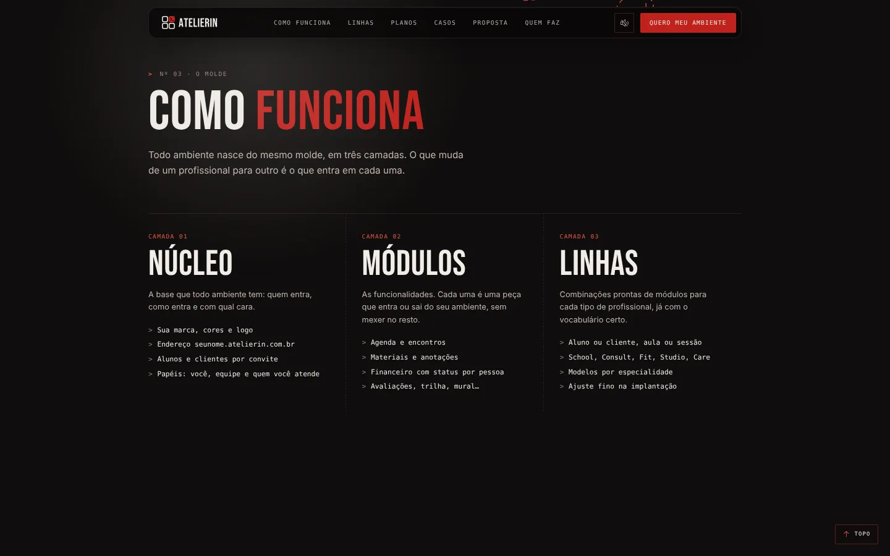

| Item | Valor |
|---|---|
| Arquivo | `sections/How.jsx` |
| Texto | `content.how` (`layers`, `modules`, `bridge`) |
| Envolvida por | `ExitStage to="light"` com a classe `how-stage` |

- Três camadas lado a lado: **Núcleo**, **Módulos** e **Linhas**.
- Termina com o painel **"Você escolhe as peças"**, centralizado e montado sobre a divisa entre o escuro e o claro. `.how > .wrap` usa `display: flow-root` para o painel poder vazar sem a margem colapsar.
- Ao rolar, a seção inteira encolhe como um cartão e revela o claro do passo a passo.

### $ passo a passo

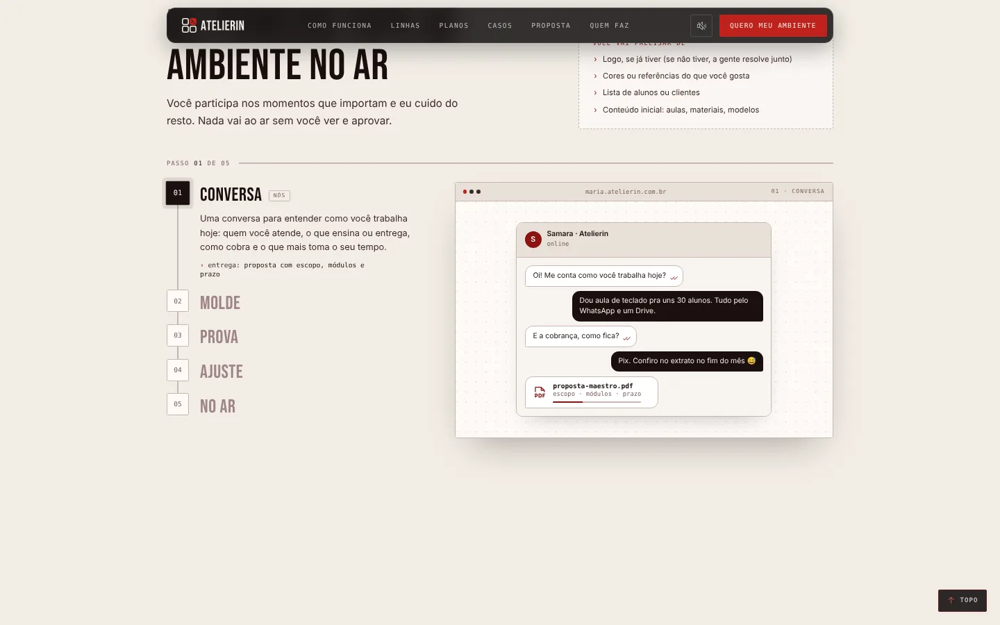

| Item | Valor |
|---|---|
| Arquivo | `sections/Steps.jsx`, `components/Pipeline.jsx`, `components/StepMock.jsx` |
| Texto | `content.how.steps` (`items[]` com título, texto, `actors`, `needs`, `image`) |

- Cinco passos: **Conversa, Molde, Prova, Ajuste, No ar**.
- No desktop, o contêiner tem altura de `n × 68vh` e a moldura fica `sticky`. A trilha à esquerda se preenche com `--p` e o passo ativo troca conforme a rolagem (mesmo esquema da pipeline da Check.AI).
- Cada passo mostra uma janela de navegador. Sem imagem em `image.src`, aparece a **telinha animada** do `StepMock`: conversa no WhatsApp, molde, PDF de prova, ajustes marcados, ambiente publicado. Cada uma roda um roteiro curto em cenas (`useScenes`, `Typed`, `Cursor`).
- No celular e com reduzir movimento, os passos ficam todos abertos, um embaixo do outro.

### $ linhas

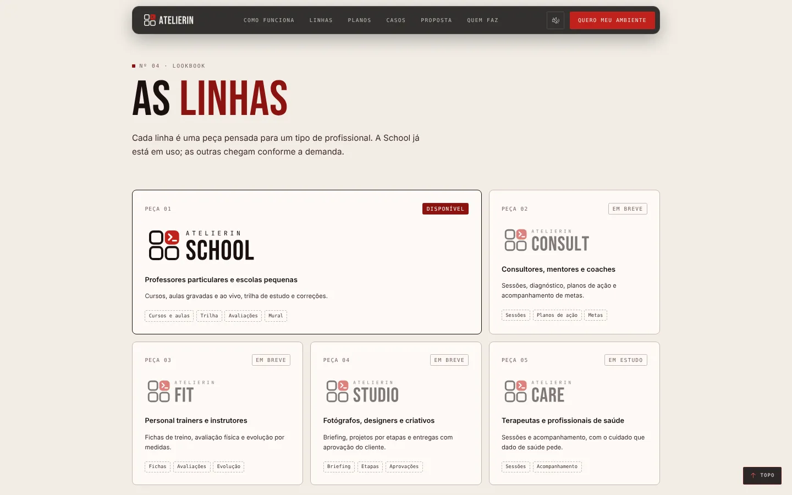

| Item | Valor |
|---|---|
| Arquivo | `sections/Lines.jsx` |
| Texto | `content.lines` (título) e `lines.json` (uma entrada por linha) |
| Envolvida por | `ExitStage to="dark"` |

- Só a linha com status **"Disponível"** ganha card maior e selo crimson. As outras usam "Em breve" ou "Em estudo".
- O `id` de cada linha precisa bater com o logo em `public/brand/atelierin-{id}-tinta-terminal-crimson.svg`.

### $ a marca é sua

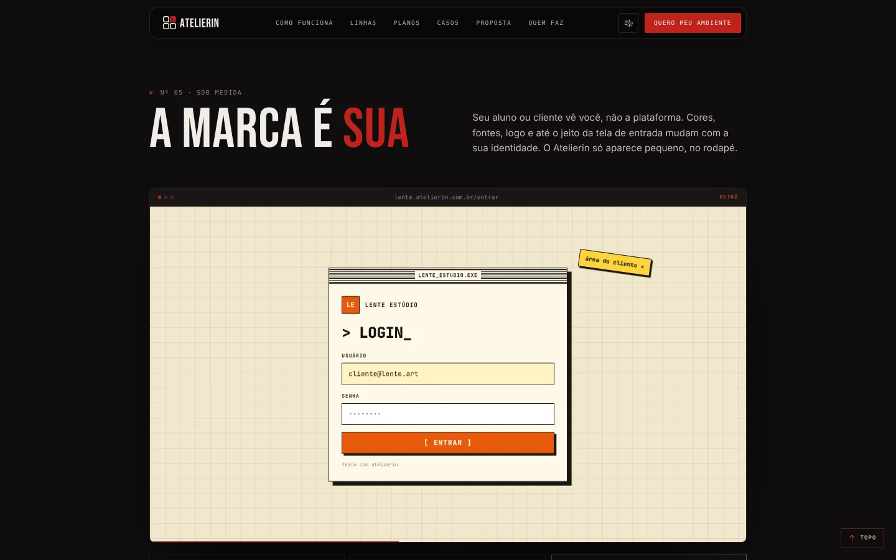

| Item | Valor |
|---|---|
| Arquivo | `sections/Custom.jsx`, `components/LoginShowcase.jsx` |
| Texto | `content.custom` (`showcase` com as três telas) |
| Envolvida por | `ExitStage to="light"` |

- O mesmo ambiente com **três identidades** de login: editorial, moderno e retrô.
- Cada tela entra com um recorte em círculo (`clip-path`), os elementos chegam em sequência e o e-mail e a senha se digitam sozinhos. O ciclo tem cinco cenas: entrada, e-mail, senha, clique e pausa.
- Pausa com o mouse em cima. Com reduzir movimento, não troca sozinho.
- **Não pisca nem passa por tela preta:** a tela nova entra por cima da anterior.

### $ planos

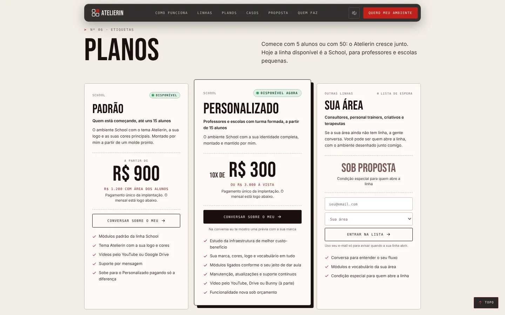

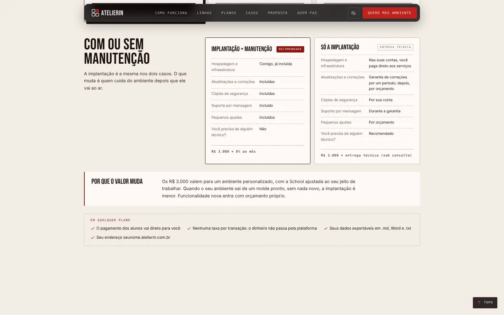

| Item | Valor |
|---|---|
| Arquivo | `sections/Plans.jsx` |
| Texto | `content.plans` (`items`, `includes`, `pricingNote`, `modes`, `proposal`) |

- Três cards: **School Personalizado** (disponível), **Padrão** (assinatura, em breve) e **Outras linhas** (sob proposta).
- O preço tem três partes: `pricePre` + `price` em destaque ("10x de R$ 300"), `priceSub` em crimson ("ou R$ 3.000 à vista") e `priceExtra` (a manutenção de 8%).
- Abaixo, o bloco **"Com ou sem manutenção"** compara as duas formas de contratar, linha a linha, e uma nota explica por que o valor muda entre ambientes.
- A ponte no fim leva para `/proposta`.
- Daqui para baixo a página **não tem mais** o efeito de cartão. O conteúdo e as decisões de preço estão em aberto no [`LP-ADR-005`](decisoes/LP-ADR-005-preco-na-pagina.md).

### $ dúvidas

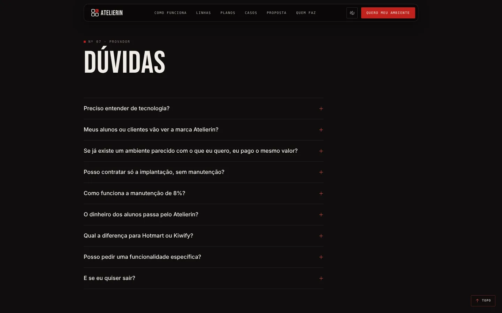

| Item | Valor |
|---|---|
| Arquivo | `sections/Faq.jsx` |
| Texto | `faq.json` (lista de `{ q, a }`) |

Acordeão com `
`, em tema escuro, entre Planos e a ficha (ambos claros). Inclui as perguntas sobre preço do molde, implantação sem manutenção, como funcionam os 8% e por que o dinheiro dos alunos não passa pela plataforma.

### $ ficha

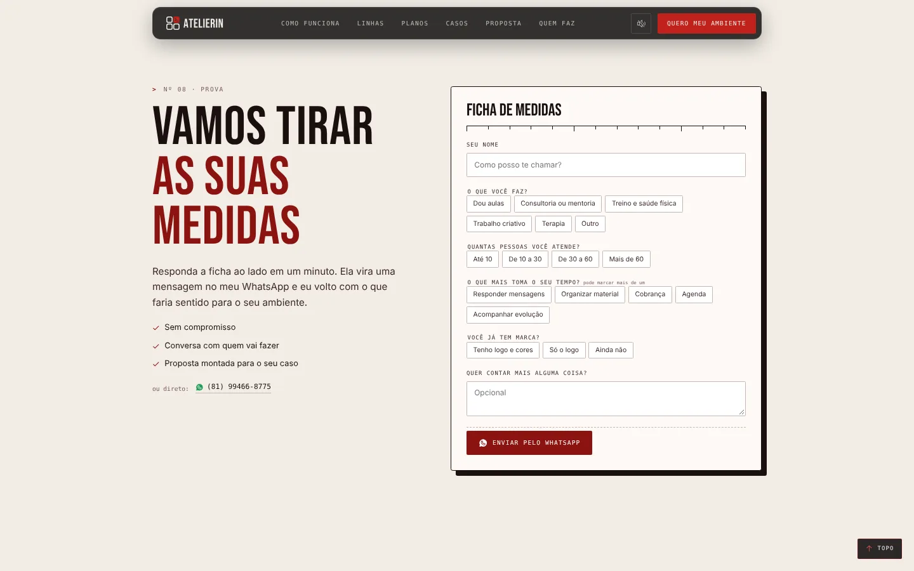

| Item | Valor |
|---|---|
| Arquivo | `sections/FinalCta.jsx` |
| Texto | `content.finalCta` (`form` com `name`, `groups` de área, tamanho, dor e marca, `note`) |

- "Vamos tirar as suas medidas": nome, chips de escolha e um campo livre.
- O botão monta a mensagem com o que foi marcado e abre o WhatsApp (`whatsappWith`). Se `site.contactEmail` estiver preenchido, aparece também o botão de e-mail.
- Nada é enviado para servidor. A conversa começa no WhatsApp da autora.

### $ rodapé

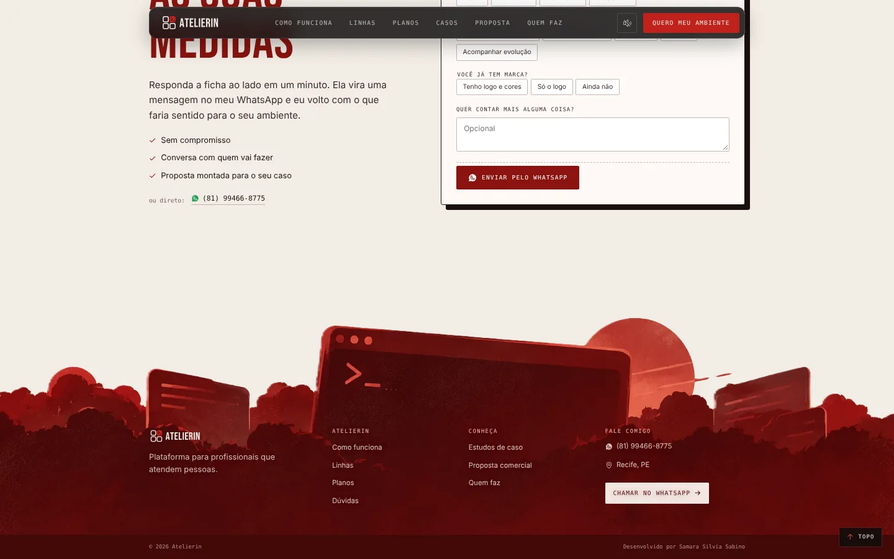

| Item | Valor |
|---|---|
| Arquivo | `sections/Footer.jsx` |
| Texto | `content.footer` (`text`, `cols`, `contactTitle`, `cta`, `credit`) |
| Imagem | `public/footer-carmesim.webp` |

A ilustração é o **fundo** do `.foot-body` (largura total, presa no topo). A partir de 20% da largura da tela, um carmesim sólido `#520A0A` continua por baixo, então o texto fica sobre a arte e o rodapé cresce sem cortar a ilustração.

### $ páginas internas

| Página | Arquivo | Estrutura |
|---|---|---|
| Quem faz | `pages/About.jsx` | Cabeçalho com nome, cargo e foto (`/samara.webp`, preto e branco), fatos, blocos de formação e experiência, ferramentas, projetos e links |
| Proposta | `pages/Proposal.jsx` | Capa e oito slides de altura quase total: um ambiente seu, o que entra na implantação, depois que está no ar, o dinheiro vai direto para você, investimento (10x de R$ 300 + 8%), quem cuida depois, o que não está incluso e começa com uma conversa |
| Casos | `pages/Cases.jsx` | Lista de estudos de caso. O 01 é o Atelier.sh na ETE Cícero Dias |

<table>
<tr>
<td width="33%">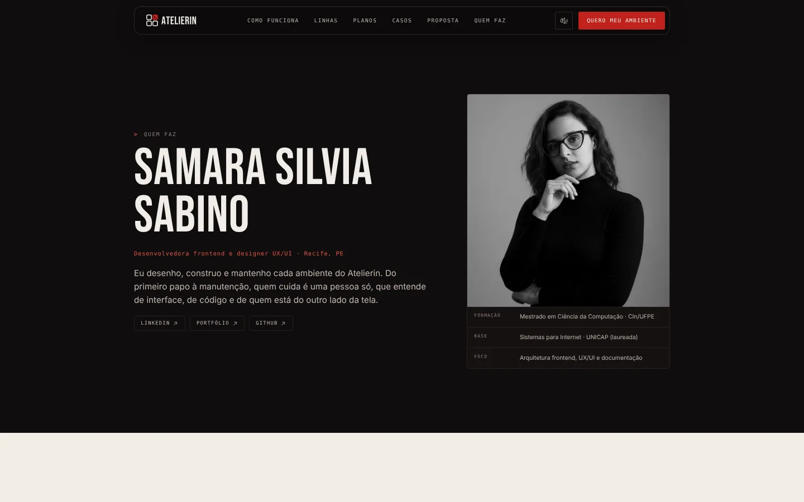</td>
<td width="33%">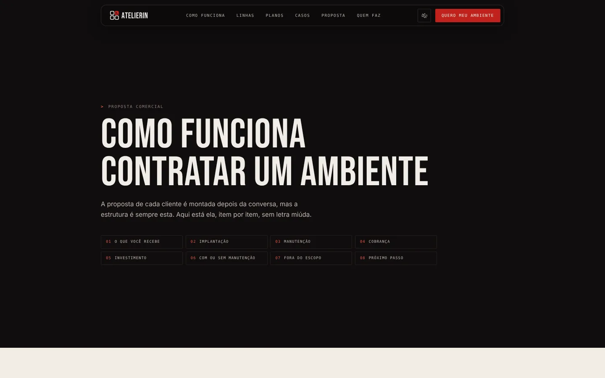</td>
<td width="33%">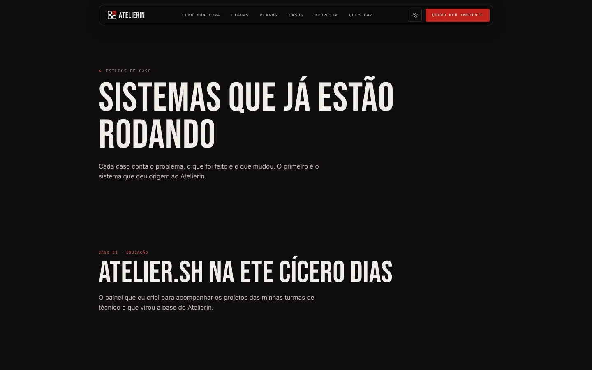</td>
</tr>
<tr>
<td align="center">Quem faz</td>
<td align="center">Proposta</td>
<td align="center">Casos</td>
</tr>
</table>

As três usam `PageHead` (rótulo, título e texto de abertura) e leem de `pages.json`.

### $ celular

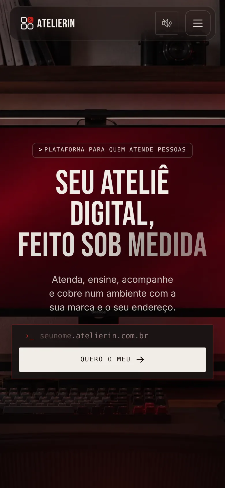

- Abaixo de 1100 px não há zoom de 80%.
- No hero, o layout do modo Figma é ignorado: os blocos saem do monitor e ficam empilhados sobre a foto.
- A trilha do passo a passo vira lista aberta.
- O efeito de cartão continua igual ao do desktop.

---

<picture>
  <source media="(prefers-color-scheme: light)" srcset="../_assets/banners/docs/rodape-claro.webp">
  
</picture>
