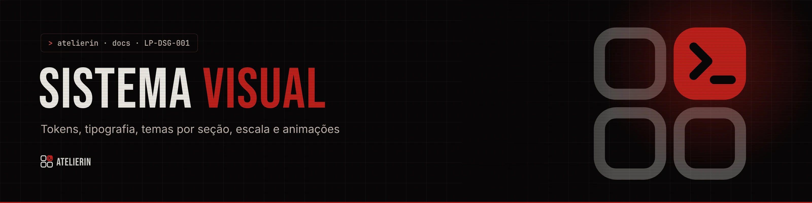
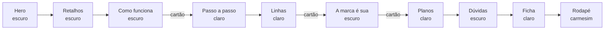

<picture>
  <source media="(prefers-color-scheme: light)" srcset="../_assets/banners/docs/lp-dsg-001-claro.webp">
  
</picture>

# LP-DSG-001 · Sistema visual da landing

  

| Campo | Valor |
|---|---|
| Código | `LP-DSG-001` |
| Data | quarta-feira, 11/11/2026 |
| Tipo | Design |
| Status | Vigente |
| Versão do site | 0.1.0 |
| Referências | `MAR-001` · `MAR-002` · `MAR-003` (em `03-DESIGN/01-MARCA`) · [`LP-ADR-003`](decisoes/LP-ADR-003-escala-de-80.md) · [`LP-ADR-004`](decisoes/LP-ADR-004-troca-de-tema-em-cartao.md) |
| Redigido por | Samara Silvia |

**Sumário**

1. [Direção](#-direção)
2. [Tokens](#-tokens)
3. [Tipografia](#-tipografia)
4. [Temas por seção](#-temas-por-seção)
5. [Escala de 80%](#-escala-de-80)
6. [Componentes de interface](#-componentes-de-interface)
7. [Movimento](#-movimento)
8. [Sons](#-sons)
9. [Acessibilidade](#-acessibilidade)
10. [O que evitar](#-o-que-evitar)

---

### $ direção

**Ateliê de alta-costura encontra terminal.** Editorial e contido, com **um acento crimson por tela**. O vocabulário de costura (moldes tracejados, fita métrica, etiquetas, alinhavo, ficha de medidas) conta o produto: um ambiente feito sob medida. O vocabulário de terminal (prompt `>`, rótulos em mono, campos como a busca do Atelier.sh) liga a landing ao sistema de onde o Atelierin veio.

A identidade da marca é a fonte da verdade (MAR-001 a MAR-003). Este documento registra **como a landing aplica** a marca.

### $ tokens

`src/styles/tokens.css` é uma cópia de `03-DESIGN/01-MARCA/tokens/tokens.css`. Os nomes de papel (`--bg`, `--text`, `--acc`...) são os mesmos do Atelier.sh. **Nenhum componente usa cor solta**: tudo passa por token.

| Papel | Escuro | Claro | Uso |
|---|---|---|---|
| `--bg` | `#100D0D` | `#F2EDE6` areia | Fundo da seção |
| `--bg-card` | `#171313` | `#FDFAF7` linho | Cards |
| `--text` | `#F0EDE8` osso | `#1A0F0F` tinta | Texto principal |
| `--text-sub` | `#C4B8B0` cinza | `#3D2828` | Texto secundário |
| `--text-muted` | `#957D7D` poeira | `#7A5A5A` | Rótulos, metadados |
| `--acc` | `#C0211C` crimson | `#8B1410` sangue | Botões, títulos em destaque |
| `--acc-text` | `#E5564B` brasa | `#8B1410` | Links e texto pequeno em destaque |
| `--border` | `#2A1E1E` | `#C8B8B0` | Bordas e réguas |

**Ajuste da landing:** no escuro, `--bg`, `--bg-card` e `--border` sobem um pouco acima do noir puro (`#080606`), para a tela não "furar" entre seções. O ajuste fica no topo de `global.css`.

Cores fora dos tokens, com motivo:

| Cor | Onde | Motivo |
|---|---|---|
| `#520A0A` | Rodapé | Carmesim escuro que continua a ilustração `footer-carmesim` |
| `#0b0707` | Fundo do hero | Cor da foto, para não aparecer faixa enquanto a imagem carrega |
| Paletas das três telas de login | `LoginShowcase` | São identidades **de clientes fictícios**, não da Atelierin |

### $ tipografia

| Fonte | Papel | Regras |
|---|---|---|
| **Bebas Neue** (`--font-display`) | Títulos | Sempre em caixa alta. A parte em destaque (`titleAccent`) vai em crimson |
| **Inter** (`--font-body`) | Texto corrido e interface | 16 px de base, entrelinha 1,6 |
| **JetBrains Mono** (`--font-mono`) | Rótulos, selos, preços pequenos, campos de terminal | Caixa alta com espaçamento `.08em` nos rótulos |

As três vêm do `@fontsource`, servidas pelo próprio site.

Padrão de título de seção: rótulo mono `Nº 0X · Nome` (a "peça"), título Bebas em duas cores e um parágrafo curto de abertura.

### $ temas por seção

Cada `<section>` declara `data-theme="dark"` ou `"light"`, e os tokens mudam dentro dela. A página alterna para dar ritmo:



Toda troca de escuro para claro (ou o contrário) até Planos acontece com a seção **saindo de cena como um cartão** ([`LP-ADR-004`](decisoes/LP-ADR-004-troca-de-tema-em-cartao.md)):

```css
.exit-stage > section {
  transform: scale(calc(1 - var(--exit) * .06));
  border-radius: 0 0 calc(var(--exit) * 56px) calc(var(--exit) * 56px);
}
.exit-stage.to-light { background: var(--palette-areia); }  /* a cor que aparece por trás */
```

### $ escala de 80%

No desktop (a partir de 1100 px), a página inteira aparece como se o navegador estivesse em 80%:

```css
:root { --z: 1; }
@media (min-width: 1100px) { :root { --z: .8; } html { zoom: var(--z); } }
```

**Regra:** toda conta com `vw` ou `svh` divide por `var(--z)`, porque unidades de tela não encolhem com o `zoom`. Exemplos:

| Onde | Conta |
|---|---|
| Altura do hero | `calc(100svh / var(--z))` |
| Largura da foto do hero | `max(calc(100vw / var(--z)), ...)` |
| Altura da trilha do passo a passo | `calc(var(--n) * 68vh / var(--z))` |
| Largura base do rodapé | `--foot-w: calc(100vw / var(--z))` |
| Slides da proposta | `min-height: calc(92svh / var(--z))` |

Detalhes e alternativas no [`LP-ADR-003`](decisoes/LP-ADR-003-escala-de-80.md).

### $ componentes de interface

| Peça | Como é |
|---|---|
| **Topbar** | Barra de vidro flutuante (`backdrop-filter: blur(18px)`), links em mono com sublinhado crimson no hover, botão de som e CTA crimson "Quero meu ambiente" |
| **Campo de endereço** | No jeito da busca do Atelier.sh: prompt `>`, texto mono, sufixo `.atelierin.com.br` |
| **Chips** | Etiqueta de terminal com ícone Phosphor e borda fina |
| **Cards de retalho** | Formato dos cards de grupo do Atelier.sh: cabeçalho mono, contador, rodapé com ação |
| **Botões** | Retangulares, rótulo mono em caixa alta, seta à direita. Primário escuro sobre claro; secundário só com borda |
| **Painel "Você escolhe as peças"** | Centralizado sobre a divisa entre escuro e claro, com sombra longa |
| **Cards de plano** | O disponível tem borda escura e sombra deslocada (efeito de peça sobre a mesa) |
| **Ficha** | Papel claro com fita métrica no topo, chips de escolha e botão do WhatsApp |
| **Voltar ao topo** | Botão fixo no canto, aparece depois da primeira tela |

Ícones: sempre **Phosphor**, sem emoji.

### $ movimento

| Animação | Onde | Gatilho |
|---|---|---|
| `rise` / `.is-in` | Elementos com `data-reveal` | Entrar na tela (`useReveal`) |
| `settle` | Foto do hero | Carregar a página |
| `card-in` | Cards de retalho | Trocar o filtro |
| Costura | `Stitch` em Retalhos | Rolagem (`useScrollProgress`) |
| Cartão | `ExitStage` | Rolagem (`useExitProgress`) |
| Trilha | `Pipeline` | Rolagem (`useStickyProgress`) |
| `sm-*` | Telinhas do `StepMock` | Passo ficar ativo |
| `lg-wipe`, `lg-rise` | `LoginShowcase` | Ciclo automático |

Regras que vieram do retorno da autora:

- **Nada pisca e nada passa por tela preta.** A troca do login entra por cima da tela anterior.
- **Movimento conta algo.** A costura liga o problema à solução; o cartão marca a troca de assunto; a trilha mostra a ordem dos passos.
- **De Planos em diante a página fica parada.** É a parte em que a pessoa lê preço e decide.

### $ sons

`lib/sounds.js` sintetiza os sons com Web Audio, no estilo do Atelier.sh. Ficam **desligados por padrão** (`site.soundsDefault: false`). A pessoa liga pelo alto-falante da topbar, e a escolha fica salva no navegador (`atelierin:sons`).

| Som | Quando |
|---|---|
| `tick` | Passar o mouse em itens clicáveis |
| `click` | Clicar em botão, filtro, passo |
| `key` | Digitar no campo de endereço e na ficha |
| `on` | Ligar os sons |

### $ acessibilidade

- Link "Pular para o conteúdo" no topo.
- Foco visível em tudo (`outline` brasa de 2 px).
- Cada seção com `aria-labelledby` apontando para o título.
- **Reduzir movimento:** sem cartão, sem trilha presa (passos abertos), sem troca automática do login, telinhas no estado final, tudo revelado.
- Contraste: a poeira subiu de `#8A7272` para `#957D7D` para passar 4,5:1 nos cards (MAR-001).
- Imagens decorativas com `alt=""` e `aria-hidden`; fotos com descrição.

### $ o que evitar

- Mais de um acento crimson forte na mesma tela.
- Cor fixa fora de `tokens.css`, a não ser nos casos listados acima.
- `vw` ou `svh` sem dividir por `--z`.
- Ações que só aparecem no hover.
- Emoji na interface.
- Animação piscando, tela preta entre estados, ou efeito em seção de decisão (Planos, Dúvidas, Ficha).

---

<picture>
  <source media="(prefers-color-scheme: light)" srcset="../_assets/banners/docs/rodape-claro.webp">
  
</picture>
