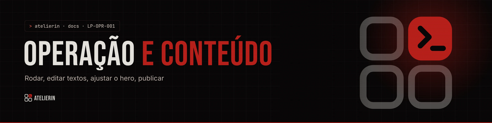
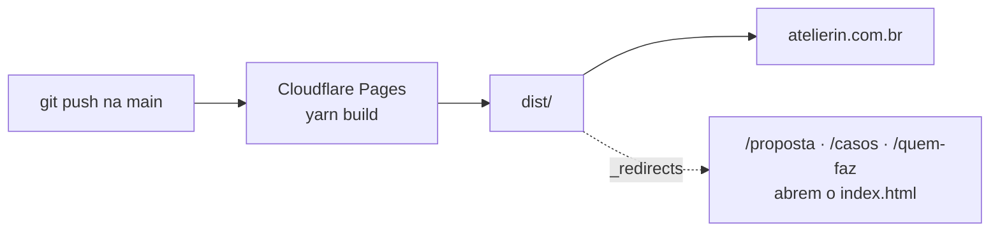

<picture>
  <source media="(prefers-color-scheme: light)" srcset="../_assets/banners/docs/lp-opr-001-claro.webp">
  
</picture>

# LP-OPR-001 · Operação e conteúdo

  

| Campo | Valor |
|---|---|
| Código | `LP-OPR-001` |
| Data | quarta-feira, 11/11/2026 |
| Tipo | Operação |
| Status | Vigente |
| Versão do site | 0.1.0 |
| Substitui | `docs/conteudo.md` |
| Referências | [`LP-ARQ-001`](LP-ARQ-001-arquitetura.md) · [`LP-ARQ-002`](LP-ARQ-002-mapa-de-secoes.md) · [`LP-ADR-001`](decisoes/LP-ADR-001-conteudo-em-json.md) |
| Redigido por | Samara Silvia |

**Sumário**

1. [Rodar](#-rodar)
2. [Editar textos](#-editar-textos)
3. [Regras de conteúdo](#-regras-de-conteúdo)
4. [Ajustar o hero](#-ajustar-o-hero)
5. [Trocar imagens](#-trocar-imagens)
6. [Contato](#-contato)
7. [Publicar](#-publicar)
8. [Antes de publicar](#-antes-de-publicar)
9. [Conferência visual](#-conferência-visual)
10. [Commits](#-commits)

---

### $ rodar

```bash
yarn            # primeira vez, ou depois de mudar o package.json
yarn dev        # http://localhost:5173
yarn build      # gera dist/
yarn preview    # serve o dist/ em http://localhost:4173
```

| Problema | O que fazer |
|---|---|
| Página em branco no `yarn dev` | Abrir o console (F12). Quase sempre é vírgula sobrando ou faltando num JSON |
| `/proposta` dá 404 no `yarn preview` | Normal no preview do Vite em alguns casos. No Cloudflare o `_redirects` resolve |
| Mudou o JSON e não atualizou | Salvar de novo o arquivo. Se persistir, parar e rodar `yarn dev` outra vez |

### $ editar textos

Todo texto fica em `src/content/`. Não precisa mexer em componente para trocar texto.

| Arquivo | O que tem |
|---|---|
| `content.json` | `site` (contato, sons), `a11y`, `nav`, `navCta`, `hero`, `problem`, `how` (inclui `steps`), `lines` (título), `custom`, `plans`, `finalCta`, `footer` |
| `lines.json` | Uma entrada por linha. `id` precisa bater com o logo em `public/brand/atelierin-{id}-tinta-terminal-crimson.svg` |
| `faq.json` | `piece`, `title` e `items` com `{ q, a }` |
| `pages.json` | `about` (Quem faz), `proposal` (slides da Proposta), `cases` (Casos) |

O mapa de qual chave vai para qual seção está no [`LP-ARQ-002`](LP-ARQ-002-mapa-de-secoes.md).

### $ regras de conteúdo

| Regra | Como |
|---|---|
| **Esconder uma seção** | `"enabled": false` no bloco dela em `content.json` (ex.: `"plans": { "enabled": false, ... }`) |
| **Título com destaque** | `title` é a parte normal, `titleAccent` a parte em crimson. Vazio se não quiser destaque |
| **Status das linhas** | Só `"Disponível"` ganha card maior e selo crimson. Use `"Em breve"` ou `"Em estudo"` nas outras |
| **Ícones** | Nomes do Phosphor que o componente já importa. Nos retalhos, o mapa é `ICONS` em `sections/Problem.jsx`: importe o ícone novo lá e acrescente no mapa |
| **Preço do plano** | `pricePre` (pequeno, antes), `price` (grande), `priceSub` (mono crimson), `priceExtra` (texto de apoio). Qualquer um pode ficar vazio |
| **Links internos** | Comece com `/` (ex.: `/proposta`, `/#planos`). O roteador intercepta sozinho |
| **Preços e manutenção** | Mudou valor, mude nos três lugares: `content.json > plans`, `faq.json` e `pages.json > proposal`. A decisão está no [`LP-ADR-005`](decisoes/LP-ADR-005-preco-na-pagina.md) |
| **Texto** | Frases curtas, sem travessão, sem "sem comissão" (existe a manutenção de 8%) |

> **Atenção ao JSON:** aspas duplas, vírgula entre itens e nenhuma vírgula depois do último. Um erro deixa a página em branco.

### $ ajustar o hero

O hero tem um **modo Figma** para posicionar os textos dentro do monitor.

1. Rode `yarn dev`. No canto inferior esquerdo aparece **Editar layout** (não vai para o site publicado). Outra forma: abrir a página com `?editar` no fim do endereço, que funciona até no build.
2. **Arraste** o selo, o título, o texto e o campo de endereço. Eles grudam no centro do monitor; segure **Alt** para soltar livre.
3. **Clique** num bloco para selecionar (borda vermelha):
   - setas movem 0,5% (com **Shift**, 2%)
   - **+** e **-** aumentam e diminuem; **0** volta ao tamanho normal
   - **Esc** solta a seleção
4. **Copiar layout** e cole em `content.json`, no lugar de `hero.layout` (a linha `_comoUsar` pode ficar).
5. **Voltar ao do content.json** descarta o que foi mexido.

`x` e `y` são % da tela do monitor (50, 50 = centro; `y: 100` = borda de baixo) e `s` é o tamanho (1 = normal). Como tudo é proporcional, a posição se mantém em qualquer tela deitada. No celular e em telas em pé o layout é ignorado e os blocos ficam empilhados.

### $ trocar imagens

| Imagem | Arquivo | Formato |
|---|---|---|
| Foto do hero | `public/hero-desk.webp` (+ `.jpg` de reserva) | Mesma proporção, 1589 × 989. Se mudar a foto, a caixa do monitor precisa ser recalculada em `global.css` |
| Ilustração do rodapé | `public/footer-carmesim.webp` | Transparente em cima, opaca a partir de ~60% da altura |
| Foto da Quem faz | `public/samara.webp` | Retrato vertical, até ~100 KB |
| Caso Atelier.sh | `public/caso-atelier-sh-ete.webp` | |
| Passo a passo | `how.steps.items[].image.src` | Print 16:10 do ambiente real. Vazio = telinha animada |
| Logos | `public/brand/` | Copiar de `03-DESIGN/01-MARCA/logos` |

Converter para WebP com qualidade 80 a 90 (por exemplo no squoosh.app).

### $ contato

| Campo | Onde | Valor atual |
|---|---|---|
| WhatsApp | `site.whatsapp` | `5581994668775` (só números, com DDI e DDD) |
| WhatsApp exibido | `site.whatsappDisplay` | `(81) 99466-8775` |
| Mensagem padrão | `site.whatsappMessage` | Usada pelos botões que não montam texto |
| E-mail | `site.contactEmail` | Vazio. Enquanto vazio, o botão de e-mail não aparece |
| Sons ligados ao abrir | `site.soundsDefault` | `false` |

### $ publicar

Cloudflare Pages, ligado ao repositório:

| Campo | Valor |
|---|---|
| Framework | Nenhum (ou Vite) |
| Comando de build | `yarn build` |
| Pasta de saída | `dist` |
| Variável `NODE_VERSION` | `20` |
| Domínio | `atelierin.com.br` |



Não há variáveis de ambiente nem segredos: o site não fala com nenhum servidor.

### $ antes de publicar

- [x] WhatsApp preenchido
- [ ] E-mail completo em `site.contactEmail`
- [ ] Oferta de Assinatura e opção sem manutenção resolvidas ([`LP-ADR-005`](decisoes/LP-ADR-005-preco-na-pagina.md))
- [ ] Imagens reais no passo a passo
- [ ] `og:image` 1200 × 630 no `index.html`
- [ ] Textos revisados com o caso do Maxwell, com autorização dele
- [ ] `yarn build` sem erro e conferência visual (abaixo)

### $ conferência visual

Não há testes automatizados. Depois de qualquer mudança grande, conferir em `yarn preview`:

| Largura | O que olhar |
|---|---|
| 1440 px | Escala de 80%, hero dentro do monitor, cartões entre seções, trilha do passo a passo presa |
| 1100 px | Limite do zoom: nada deve pular ou cortar |
| 768 px | Tablet: hero empilhado, cards em duas colunas |
| 390 px | Celular: menu, ficha, planos em uma coluna |

E uma passada com **reduzir movimento** ligado no sistema.

### $ commits

Inglês, curtos, com prefixo:

```bash
git commit -m "feat: add cases page"
git commit -m "fix: hero address field on mobile"
git commit -m "style: footer text over illustration"
git commit -m "docs: landing documentation"
```

O `README.md` e o `CHANGELOG.md` são atualizados a cada versão.

---

<picture>
  <source media="(prefers-color-scheme: light)" srcset="../_assets/banners/docs/rodape-claro.webp">
  
</picture>
