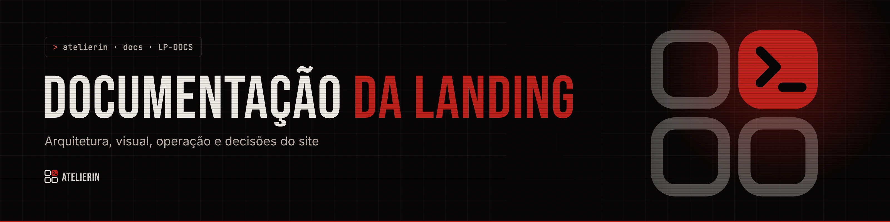

<picture>
  <source media="(prefers-color-scheme: light)" srcset="../_assets/banners/docs/lp-indice-claro.webp">
  
</picture>

# Documentação da landing

  

| Campo | Valor |
|---|---|
| Atualizado | quarta-feira, 11/11/2026 |
| Redigido por | Samara Silvia |
| Banners | gerados com `03-DESIGN/01-MARCA/ferramentas/gerador-banners-atelierin.html`; presets em [`_assets/gerador/banners-landing.json`](../_assets/gerador/banners-landing.json) |

**Sumário**

1. [Documentos](#-documentos)
2. [Ordem de leitura](#-ordem-de-leitura)
3. [Como os documentos se organizam](#-como-os-documentos-se-organizam)
4. [Padrão de cada documento](#-padrão-de-cada-documento)
5. [Criando um documento novo](#-criando-um-documento-novo)

---

### $ documentos

| Código | Título | Tipo | Status |
|---|---|---|---|
| [`LP-ARQ-001`](LP-ARQ-001-arquitetura.md) | Arquitetura da landing | Arquitetura | Vigente |
| [`LP-ARQ-002`](LP-ARQ-002-mapa-de-secoes.md) | Mapa de seções e páginas | Arquitetura | Vigente |
| [`LP-DSG-001`](LP-DSG-001-sistema-visual.md) | Sistema visual da landing | Design | Vigente |
| [`LP-OPR-001`](LP-OPR-001-operacao-e-conteudo.md) | Operação e conteúdo | Operação | Vigente |
| [`LP-ADR-001`](decisoes/LP-ADR-001-conteudo-em-json.md) | Conteúdo em JSON | Decisão | Aceita |
| [`LP-ADR-002`](decisoes/LP-ADR-002-roteador-proprio.md) | Roteador próprio | Decisão | Aceita |
| [`LP-ADR-003`](decisoes/LP-ADR-003-escala-de-80.md) | Escala de 80% no desktop | Decisão | Aceita |
| [`LP-ADR-004`](decisoes/LP-ADR-004-troca-de-tema-em-cartao.md) | Troca de tema em cartão | Decisão | Aceita |
| [`LP-ADR-005`](decisoes/LP-ADR-005-preco-na-pagina.md) | Preço na página: dois degraus | Decisão | Aceita |

### $ ordem de leitura

1. [`LP-OPR-001`](LP-OPR-001-operacao-e-conteudo.md) para rodar e editar textos
2. [`LP-ARQ-002`](LP-ARQ-002-mapa-de-secoes.md) para achar a seção certa
3. [`LP-ARQ-001`](LP-ARQ-001-arquitetura.md) antes de mexer em código
4. [`LP-DSG-001`](LP-DSG-001-sistema-visual.md) antes de mexer em visual
5. Os ADRs quando surgir um "por que assim?"

### $ como os documentos se organizam

O prefixo `LP-` separa os documentos da **landing** dos documentos da **plataforma**, que ficam em `PRD-ATELIERIN/00-DOCS` (`PRD`, `ARQ`, `DSG`, `OPR`) e em `03-DESIGN/01-MARCA` (`MAR`). Assim um `ARQ-001` da plataforma nunca se confunde com o da landing.

| Prefixo | Tipo | Pasta | Quando criar |
|---|---|---|---|
| `LP-ARQ` | Arquitetura | `docs/` | Como as partes se encaixam. Muda pouco |
| `LP-DSG` | Design | `docs/` | Como a landing aplica a marca: tokens, temas, movimento |
| `LP-OPR` | Operação | `docs/` | Rodar, editar, publicar |
| `LP-ADR` | Registro de decisão | `docs/decisoes/` | Toda escolha que teve alternativas reais e que alguém vai perguntar "por que assim?" |

**ADRs não são reescritos depois de aceitos.** Se uma decisão mudar, cria-se um ADR novo que substitui o antigo, e o antigo ganha o status `Substituída por LP-ADR-00X`. Status possíveis: `Proposta` · `Aceita` · `Substituída` · `Descartada`. Um ADR em `Proposta` pode ser editado até virar `Aceita`.

### $ padrão de cada documento

1. Banner do documento (escuro e claro), de `_assets/banners/docs/`.
2. Título no formato `CÓDIGO · Título`.
3. Badges de status, tipo e código.
4. Tabela de metadados: código, data, tipo, status, versão do site (ARQ, DSG e OPR), quem decidiu (ADR), quem redigiu e referências.
5. Sumário com links para as seções.
6. Seções com títulos `### $ minúsculos`.
7. Prints de `_assets/prints/` sempre que a seção for visual.
8. Rodapé com o banner da documentação.

Texto impessoal, frases curtas, sem travessão. Diagramas em Mermaid, que o GitHub desenha sozinho.

### $ criando um documento novo

1. Copie um documento do mesmo tipo e troque código, título e metadados.
2. Abra `03-DESIGN/01-MARCA/ferramentas/gerador-banners-atelierin.html` no navegador, importe [`_assets/gerador/banners-landing.json`](../_assets/gerador/banners-landing.json), acrescente o documento e baixe o banner nos dois temas.
3. Converta os PNG para WebP (qualidade 88 a 90, por exemplo no squoosh.app) e salve em `_assets/banners/docs/` como `codigo.webp` e `codigo-claro.webp`.
4. Exporte o JSON de novo para `_assets/gerador/banners-landing.json`.
5. Acrescente o documento na tabela acima e no README.

---

<picture>
  <source media="(prefers-color-scheme: light)" srcset="../_assets/banners/docs/rodape-claro.webp">
  
</picture>
