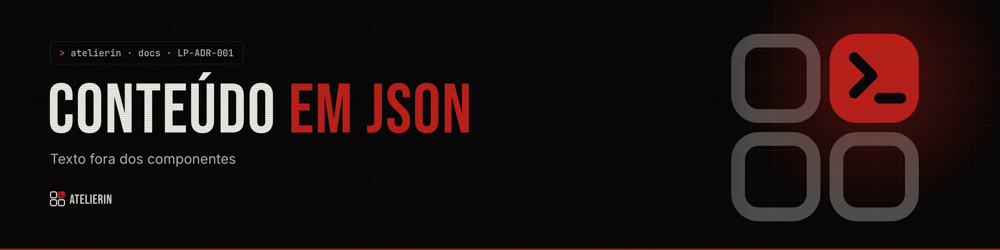

<picture>
  <source media="(prefers-color-scheme: light)" srcset="../../_assets/banners/docs/lp-adr-001-claro.webp">
  
</picture>

# LP-ADR-001 · Conteúdo em JSON

  

| Campo | Valor |
|---|---|
| Código | `LP-ADR-001` |
| Data | quarta-feira, 11/11/2026 |
| Tipo | Registro de decisão |
| Status | Aceita |
| Decisão de | Samara Silvia |
| Redigido por | Samara Silvia |

**Sumário**

1. [Contexto](#-contexto)
2. [Decisão](#-decisão)
3. [Alternativas consideradas](#-alternativas-consideradas)
4. [Consequências](#-consequências)
5. [Revisitar quando](#-revisitar-quando)

---

### $ contexto

A landing muda de texto o tempo todo: preço, chamada do hero, perguntas, casos. Quem edita nem sempre quer abrir um componente React para trocar uma frase, e texto espalhado em JSX costuma ficar desatualizado em um lugar e certo em outro. O mesmo padrão já funcionava na landing da Check.AI.

### $ decisão

1. **Todo texto visível fica em `src/content/*.json`**: `content.json` (home e site), `lines.json`, `faq.json` e `pages.json`.
2. **Um ponto único de leitura:** `lib/content.js` junta os arquivos e exporta `content`, `isEnabled`, `whatsappHref`, `whatsappWith` e `mailHref`.
3. **Cada seção lê só o próprio bloco** (`content.plans`, `content.hero`...).
4. **Ligar e desligar seção pelo JSON** com `"enabled": false`.

### $ alternativas consideradas

| Opção | Por que não |
|---|---|
| Texto direto nos componentes | Trocar uma frase exige achar o componente; preço repetido em três lugares fica fora de sincronia |
| CMS (Sanity, Contentful, Decap) | Conta externa, painel e build mais lentos para um site de uma pessoa só |
| Markdown por seção | Bom para texto corrido, ruim para listas estruturadas (planos, passos, chips) |
| Um JSON único | Ficaria com milhares de linhas. Separar linhas, FAQ e páginas facilita achar as coisas |

### $ consequências

- Trocar texto é editar JSON, sem tocar em layout.
- A estrutura do JSON vira contrato: renomear uma chave quebra a seção. O [`LP-ARQ-002`](../LP-ARQ-002-mapa-de-secoes.md) lista as chaves de cada uma.
- Um erro de sintaxe no JSON deixa a página em branco no `yarn dev`.
- Preço aparece em três arquivos (planos, FAQ, proposta). Precisa mudar nos três.

### $ revisitar quando

- Outra pessoa, sem conhecer JSON, precisar editar o site com frequência. Aí um CMS com Git (Decap, TinaCMS) passa a valer a pena.
- O site ganhar versão em outro idioma.

---

<picture>
  <source media="(prefers-color-scheme: light)" srcset="../../_assets/banners/docs/rodape-claro.webp">
  
</picture>
