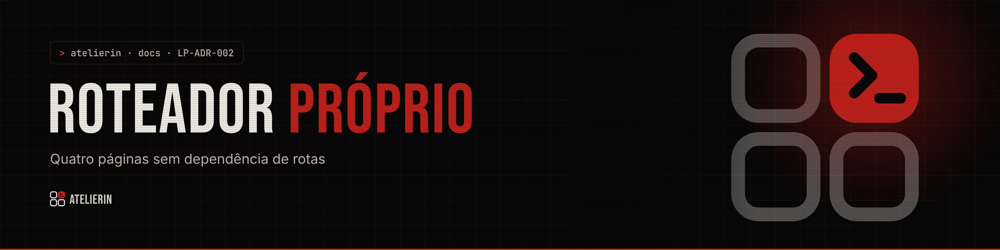

<picture>
  <source media="(prefers-color-scheme: light)" srcset="../../_assets/banners/docs/lp-adr-002-claro.webp">
  
</picture>

# LP-ADR-002 · Roteador próprio

  

| Campo | Valor |
|---|---|
| Código | `LP-ADR-002` |
| Data | quarta-feira, 11/11/2026 |
| Tipo | Registro de decisão |
| Status | Aceita |
| Decisão de | Samara Silvia |
| Redigido por | Samara Silvia |

**Sumário**

1. [Contexto](#-contexto)
2. [Decisão](#-decisão)
3. [Alternativas consideradas](#-alternativas-consideradas)
4. [Consequências](#-consequências)
5. [Revisitar quando](#-revisitar-quando)

---

### $ contexto

A landing começou com uma página só. Depois vieram **Quem faz**, **Proposta** e **Casos**, páginas que a autora manda por link nas negociações e que precisam abrir direto pelo endereço. Os links do menu misturam páginas (`/proposta`) e âncoras (`/#planos`).

### $ decisão

Um roteador mínimo em `lib/router.js`, sem dependência:

1. `usePath()` lê `location.pathname` com `useSyncExternalStore` e escuta `popstate`.
2. `navigate(to)` faz `pushState`, volta ao topo e, se houver `#ancora`, rola até ela.
3. `useLinkInterceptor()` intercepta cliques em qualquer `<a href="/...">`, então links vindos do JSON funcionam sem componente `<Link>`.
4. `useInitialHash()` rola até a âncora quando a pessoa abre `/#planos` direto.
5. `App.jsx` tem um mapa `PAGES` de caminho para componente. Caminho desconhecido cai na home.
6. No Cloudflare Pages, `public/_redirects` (`/*  /index.html  200`) entrega o `index.html` em qualquer caminho.

### $ alternativas consideradas

| Opção | Por que não |
|---|---|
| React Router | ~15 KB e uma API inteira para quatro rotas fixas |
| Rotas por hash (`/#/proposta`) | Conflita com as âncoras das seções e deixa o link feio para mandar a cliente |
| Um HTML por página (multi-page do Vite) | Header, Footer e estilos duplicados ou com build mais complexo |
| Next.js / Astro | Troca de stack inteira para resolver quatro páginas |

### $ consequências

- Zero dependência e 50 linhas de código.
- Links do JSON funcionam como links normais, inclusive com Ctrl + clique (o interceptador ignora cliques com tecla modificadora).
- Sem carregamento por página: as quatro vão no mesmo pacote. Hoje isso não pesa.
- Sem SSR: buscadores leem o conteúdo depois do JavaScript. Para uma landing que vende por indicação e WhatsApp, aceitável.

### $ revisitar quando

- O site passar de umas dez páginas, ou precisar de páginas dinâmicas (um caso por endereço, blog).
- SEO virar canal importante. Aí vale pré-renderizar (Astro ou `vite-plugin-ssr`).

---

<picture>
  <source media="(prefers-color-scheme: light)" srcset="../../_assets/banners/docs/rodape-claro.webp">
  
</picture>
