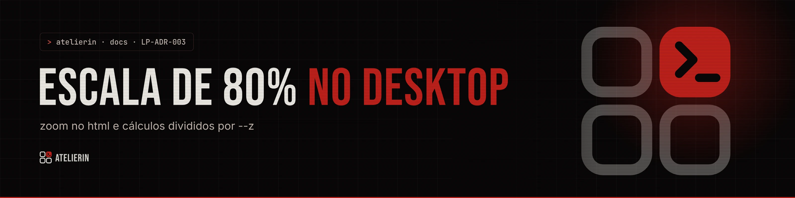

<picture>
  <source media="(prefers-color-scheme: light)" srcset="../../_assets/banners/docs/lp-adr-003-claro.webp">
  
</picture>

# LP-ADR-003 · Escala de 80% no desktop

  

| Campo | Valor |
|---|---|
| Código | `LP-ADR-003` |
| Data | quarta-feira, 11/11/2026 |
| Tipo | Registro de decisão |
| Status | Aceita |
| Decisão de | Samara Silvia |
| Redigido por | Samara Silvia |

**Sumário**

1. [Contexto](#-contexto)
2. [Decisão](#-decisão)
3. [Alternativas consideradas](#-alternativas-consideradas)
4. [Consequências](#-consequências)
5. [Revisitar quando](#-revisitar-quando)

---

### $ contexto

Desenhada a 100%, a landing ficava grande demais em notebooks: títulos Bebas enormes, poucas informações por tela e seções que pediam muita rolagem. Com o navegador em 80% ela ficava do jeito certo. A autora pediu que o site **já abrisse** assim.

### $ decisão

```css
:root { --z: 1; }
@media (min-width: 1100px) { :root { --z: .8; } html { zoom: var(--z); } }
```

1. A partir de 1100 px de largura, o `<html>` recebe `zoom: .8`.
2. **Toda conta com `vw` ou `svh` divide por `var(--z)`**, porque essas unidades medem a tela real e não encolhem com o zoom. Sem isso, o hero ficaria com 80% da altura da tela.
3. Hooks que medem posição (`useExitProgress`, `useStickyProgress`) detectam se `getBoundingClientRect` veio em pixels visuais ou de layout comparando `rect.width` com `offsetWidth`, e corrigem a altura da tela.
4. Abaixo de 1100 px, sem zoom: tablet e celular ficam a 100%.

### $ alternativas consideradas

| Opção | Por que não |
|---|---|
| Redesenhar tudo com tamanhos 20% menores | Muito trabalho e o resultado seria o mesmo. Perde a referência de 100% para celular |
| `transform: scale(.8)` no `body` | Não muda o tamanho do layout: sobra espaço em branco, `position: sticky` e `fixed` quebram |
| `font-size` do `html` em 80% com tudo em `rem` | O CSS usa px em muitos lugares (bordas, sombras, ícones); só a fonte encolheria |
| Deixar a pessoa dar zoom | Ninguém faz isso numa landing |

### $ consequências

- Uma linha resolve a escala do site inteiro.
- Regra a seguir sempre: `vw` e `svh` divididos por `--z`. Esquecer isso gera seção alta ou estreita demais só no desktop.
- `zoom` passou a ser padrão nos navegadores, mas cada um reporta medidas de um jeito. Os hooks tratam os dois casos.
- Na faixa de 1100 px o salto de 100% para 80% é visível ao redimensionar a janela. Na prática, ninguém usa nessa largura exata.

### $ revisitar quando

- Algum navegador mudar o comportamento de `zoom` com `getBoundingClientRect` de novo.
- O design for refeito do zero. Aí vale desenhar já no tamanho final e remover o zoom.

---

<picture>
  <source media="(prefers-color-scheme: light)" srcset="../../_assets/banners/docs/rodape-claro.webp">
  
</picture>
