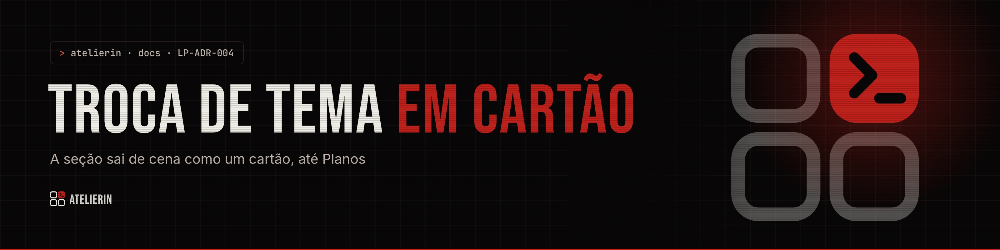

<picture>
  <source media="(prefers-color-scheme: light)" srcset="../../_assets/banners/docs/lp-adr-004-claro.webp">
  
</picture>

# LP-ADR-004 · Troca de tema em cartão

  

| Campo | Valor |
|---|---|
| Código | `LP-ADR-004` |
| Data | quarta-feira, 11/11/2026 |
| Tipo | Registro de decisão |
| Status | Aceita |
| Decisão de | Samara Silvia |
| Redigido por | Samara Silvia |

**Sumário**

1. [Contexto](#-contexto)
2. [Decisão](#-decisão)
3. [Alternativas consideradas](#-alternativas-consideradas)
4. [Consequências](#-consequências)
5. [Revisitar quando](#-revisitar-quando)

---

### $ contexto

A home alterna seções escuras e claras. Um corte seco de preto para areia ficava duro. A autora mostrou a referência do site do Miro, em que a seção vai embora como um cartão que encolhe e revela a próxima cor por trás, e aprovou o efeito ("é exatamente isso").

### $ decisão

1. O componente `ExitStage` envolve a seção que vai sair. O fundo dele é a cor da **próxima** seção (`to="light"` ou `to="dark"`).
2. `useExitProgress` escreve `--exit` (0 a 1) na seção conforme a base dela sobe: 0 com a base no pé da tela, 1 quando chega a 35% da altura.
3. O CSS faz o resto: escala de 1 para 0,94, cantos de baixo de 0 a 56 px, sombra crescendo.
4. Usado em **Como funciona** (para o claro), **Linhas** (para o escuro) e **A marca é sua** (para o claro).
5. **De Planos em diante, sem o efeito.** É a parte de leitura e decisão; foi pedido para parar ali.
6. Com reduzir movimento, o hook não roda e a seção fica parada.

### $ alternativas consideradas

| Opção | Por que não |
|---|---|
| Corte seco entre temas | Duro, sobretudo do escuro para o claro |
| Degradê entre as cores | Fica cinza-marrom no meio e parece erro |
| Efeito em todas as seções | Cansa e atrapalha a leitura de preço e dúvidas |
| Biblioteca de animação (GSAP ScrollTrigger, Framer Motion) | Dependência grande para um efeito que cabe em 30 linhas |

### $ consequências

- Troca de tema com cara de produto, sem dependência.
- A seção dentro do `ExitStage` precisa ser o **primeiro filho** dele.
- Como a seção encolhe, elementos que vazam para fora dela (o painel "Você escolhe as peças") precisam de `z-index` no invólucro (`how-stage`) para passar por cima da seção seguinte. A costura dos retalhos, por sua vez, precisou de `z-index: 3` em `.problem`.
- Um `scroll` com `requestAnimationFrame` por seção envolvida. Três no total, sem impacto perceptível.

### $ revisitar quando

- Entrar seção nova que muda de tema antes de Planos: envolver com `ExitStage`.
- `animation-timeline: view()` estiver em todos os navegadores. Aí o efeito pode virar só CSS, sem hook.

---

<picture>
  <source media="(prefers-color-scheme: light)" srcset="../../_assets/banners/docs/rodape-claro.webp">
  
</picture>
