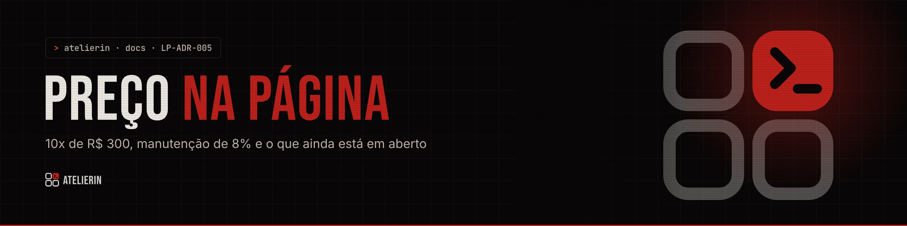

<picture>
  <source media="(prefers-color-scheme: light)" srcset="../../_assets/banners/docs/lp-adr-005-claro.webp">
  
</picture>

# LP-ADR-005 · Preço na página

  

| Campo | Valor |
|---|---|
| Código | `LP-ADR-005` |
| Data | quarta-feira, 11/11/2026 |
| Tipo | Registro de decisão |
| Status | Proposta |
| Decisão de | Samara Silvia |
| Redigido por | Samara Silvia |

**Sumário**

1. [Contexto](#-contexto)
2. [Decisão](#-decisão)
3. [Alternativas consideradas](#-alternativas-consideradas)
4. [Consequências](#-consequências)
5. [Revisitar quando](#-revisitar-quando)

---

### $ contexto

A primeira versão da landing não mostrava preço ("a conversa vem antes"). Na negociação com o primeiro cliente, ficou claro que o preço ajuda a filtrar quem chega e evita a pergunta repetida. O modelo comercial está no `PRD-005`: **setup de R$ 3.000** (à vista ou 10x de R$ 300), **manutenção de 8%** sobre o que o profissional recebe dos alunos ativos no mês e **infraestrutura** rateada.

Em 11/11/2026 o preço entrou na página. Ao revisar, a autora levantou dois conflitos que **ainda não estão resolvidos**, e por isso esta decisão está como **Proposta**.

**Conflito 1: Assinatura × "um ambiente seu".** A proposta abre com "Um ambiente seu, não uma conta numa plataforma". O card **Padrão** fala em "Assinatura". A assinatura seria, na prática, o Atelier.sh como ele é hoje: o mesmo ambiente com o tema Atelierin, logo e nome do cliente, sem implantação sob medida. Lida ao lado da frase da proposta, "assinatura" soa como "uma conta numa plataforma".

**Conflito 2: "Só a implantação" não fecha com o produto.** O comparativo "Com ou sem manutenção" oferece **só a implantação**, com hospedagem nas contas do cliente. Mas o Atelierin é **um sistema da autora**: o código, a base e o Supabase são dela, o cliente usa o serviço (PRD-005, seção Propriedade). Sem manutenção, o cliente continuaria usando o sistema sem pagar por ele. A opção só faria sentido entregando o código, o que o PRD-005 descarta.

### $ decisão

**Aceito (no ar desde 11/11/2026):**

1. O preço aparece no card **School Personalizado**: "10x de R$ 300" em destaque, "ou R$ 3.000 à vista" e "+ manutenção de 8% do que você recebe dos alunos ativos no mês".
2. Explicação curta em Planos, completa na Proposta (slide de investimento) e nas Dúvidas.
3. Nenhum texto diz "sem comissão": a manutenção é um percentual. O texto correto é "nenhuma taxa por transação" (o dinheiro dos alunos não passa pela plataforma).

**Em aberto, para decidir antes de publicar:**

| Ponto | Caminho sugerido | Alternativa |
|---|---|---|
| "Ambiente seu" | Definir na página o que é "seu": **marca, endereço, alunos e dados**. O código e a estrutura são da Atelierin | Trocar a frase da proposta por "Um ambiente com a sua cara, não um perfil numa plataforma" |
| Plano Padrão | Chamar de **"Pronto"** ou **"Padrão"**, sem a palavra assinatura, e explicar que é o mesmo ambiente com o tema Atelierin e a mesma manutenção percentual | Manter "assinatura" e mudar a frase da proposta |
| Só a implantação | **Retirar** do comparativo e do slide. A manutenção faz parte de usar o sistema, porque o sistema é da Atelierin | Manter só como "entrega do código" sob proposta, com preço muito maior e licença fechada |
| Manutenção mínima | Decidir se existe um mínimo mensal (o PRD-005 deixa em aberto) | Sem mínimo |

### $ alternativas consideradas

| Opção | Por que não |
|---|---|
| Continuar sem preço | Toda conversa começava pela pergunta do preço e atraía quem não podia pagar |
| Só o preço à vista | R$ 3.000 assusta mais do que 10x de R$ 300 para professores autônomos |
| Esconder a manutenção até a conversa | Pareceria pegadinha depois; o percentual precisa estar junto do preço |

### $ consequências

- A página e a proposta passam a ter preço; qualquer mudança precisa ser feita em `content.json > plans`, `faq.json` e `pages.json > proposal` ao mesmo tempo.
- Enquanto os pontos em aberto não forem resolvidos, a página tem uma promessa ("só a implantação") que o produto não sustenta. **Não publicar antes de decidir.**
- O preço é de fundador e vale para a linha School. Outras linhas seguem "sob proposta".

### $ revisitar quando

- A autora decidir os quatro pontos em aberto. Aí este ADR vira **Aceita** com a decisão final, ou um ADR novo o substitui.
- O plano Padrão sair do "em breve".
- O PRD-005 mudar de revisão.

---

<picture>
  <source media="(prefers-color-scheme: light)" srcset="../../_assets/banners/docs/rodape-claro.webp">
  
</picture>
