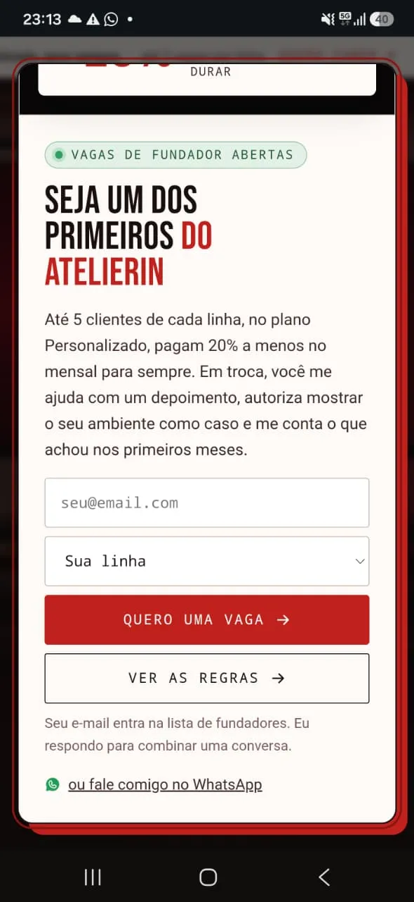
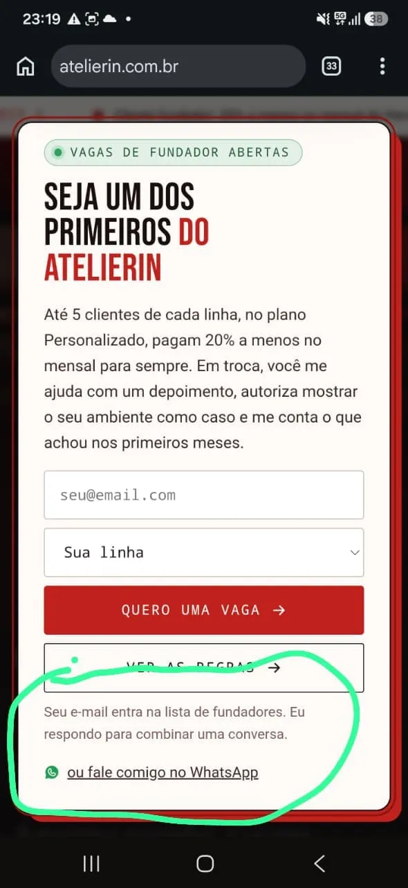
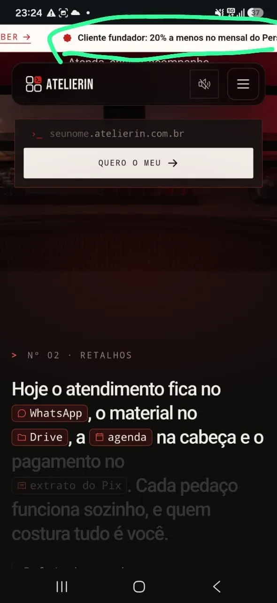

# LP-FBK-001 · Feedback do Jeff sobre o cliente fundador

17/11/2026 · Samara Silvia Sabino

Feedback de um amigo (Jeff) sobre o modal e a faixa do cliente fundador, visto no celular em produção (`atelierin.com.br`). Os três pontos viram ajustes na lista de implementação da landing.

## 1. Título e texto do modal

**O que ele disse:** para venda, desconto chama mais atenção do que "ser um dos primeiros". Focar no desconto no título ajuda a enxugar o texto. A linguagem também pode ser mais ampla, sem o "eu".

**Sugestão dele:**

| Parte | Hoje | Sugestão |
| --- | --- | --- |
| Título | Seja um dos primeiros do Atelierin | Garanta 20% off pra sempre |
| Texto | Até 5 clientes de cada linha, no plano Personalizado, pagam 20% a menos no mensal para sempre. Em troca, você me ajuda com um depoimento, autoriza mostrar o seu ambiente como caso e me conta o que achou nos primeiros meses. | Seja um dos primeiros do Atelierin a garantir desconto no plano sob medida |
| Regras | Botão "Ver as regras" | Link "Saiba mais", levando ao regulamento (`/fundador`) |

**Ajuste:** título com o desconto, texto curto e impessoal, contrapartida explicada só na página `/fundador`. "Plano personalizado" já passa a ser "sob medida" (NOT-003).

## 2. "Combinar uma conversa" x WhatsApp

**O que ele disse:** o texto promete combinar uma conversa e, logo abaixo, oferece o WhatsApp. Não faz sentido: quem tiver interesse vai chamar direto, não vai esperar a conversa ser combinada.

**Ajuste:** tirar "Eu respondo para combinar uma conversa" do consentimento e da mensagem de sucesso. O formulário só confirma que o e-mail entrou na lista; o WhatsApp fica como o caminho para quem quer falar agora.

## 3. Velocidade da faixa

**O que ele disse:** a faixa (letreiro) está rápida demais.

**Ajuste:** diminuir a velocidade do letreiro. Samara concorda.

## Status

| Ponto | Situação |
| --- | --- |
| 1. Título e texto do modal | A fazer |
| 2. Conversa x WhatsApp | A fazer |
| 3. Velocidade da faixa | A fazer |
